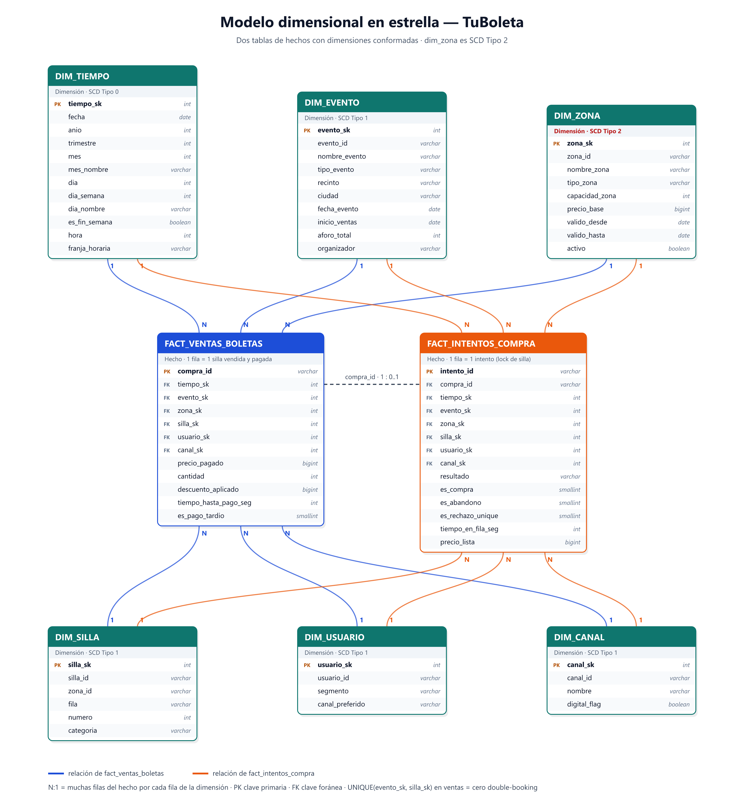

# TuBoleta Mini-Lakehouse

Mini-Lakehouse **Bronze / Silver / Gold** (Parquet + DuckDB) para analizar la venta de boletería de TuBoleta en el Estadio Atanasio Girardot (Medellín). Taller 3 de Tópicos Avanzados en Bases de Datos, ITM.

Con un solo comando (`python main.py`) el pipeline genera los datos, los limpia, los modela en estrella, ejecuta nueve consultas de negocio y mide un benchmark OLTP vs columnar.

## 1. Dominio y proceso analizado

TuBoleta vende boletería masiva. Su sistema operacional combina:

- **Redis (AP):** fila virtual, locks temporales de silla con TTL (600 s) y contadores. Es estado **efímero**.
- **CockroachDB (CP):** fuente de verdad. Guarda las compras confirmadas y evita el *double-booking* con `UNIQUE(evento, silla)` bajo `SERIALIZABLE`.

Flujo de una compra: entrar a la fila, ser admitido, bloquear una silla (lock con TTL), pagar a tiempo (`INSERT` en CockroachDB) o dejar vencer el TTL (abandono, la silla se libera). Si otro usuario ya compró la silla, el `UNIQUE` rechaza el `INSERT`.

**Procesos analizados** (detalle en [`docs/diseno_dimensional.md`](docs/diseno_dimensional.md)):

1. **Ventas:** cuántas boletas y cuánto dinero se vendió por evento, zona, canal y período. Una fila = una silla vendida y pagada.
2. **Embudo de compra:** cómo terminan los intentos de compra (compra, abandono o rechazo `UNIQUE`). Una fila = un intento.

## 2. Arquitectura

```
 OLTP (CockroachDB + Redis)         datos sintéticos (por defecto)
            |                                  |
            +----------------+-----------------+
                             v
                  BRONZE  lakehouse/bronze   Parquet crudo y sucio, versionado por extracción
                             |  scripts/transform_silver.py  (limpieza técnica)
                             v
                  SILVER  lakehouse/silver   Parquet limpio y tipado
                             |  scripts/transform_gold.py    (modelo en estrella + SCD2)
                             v
                  GOLD    lakehouse/gold     2 hechos + 6 dimensiones
                             |  DuckDB (read_parquet)
                             v
                  scripts/analyze.py         9 consultas + benchmark -> docs/
```



El modelo fuente está en [`docs/modelo_dimensional.dbml`](docs/modelo_dimensional.dbml) (se puede abrir en [dbdiagram.io](https://dbdiagram.io)); la imagen se generó a partir de ese mismo DBML.

```
DIM_TIEMPO --+                    +-- DIM_CANAL
DIM_EVENTO --+--> FACT_VENTAS_BOLETAS <--+-- DIM_USUARIO
DIM_ZONA ----+    FACT_INTENTOS_COMPRA   +-- DIM_SILLA
 (SCD Tipo 2)       (dimensiones conformadas)
```

## 3. Decisiones de diseño

### Dos tablas de hechos: los abandonos no son ventas

| Tabla | Una fila = | Para qué sirve |
|---|---|---|
| `fact_ventas_boletas` | una silla vendida y **pagada** en un evento | ingresos, boletas, ticket promedio, ocupación. Tiene `UNIQUE(evento, silla)`: el pipeline verifica que no hay *double-booking*. |
| `fact_intentos_compra` | un intento de compra (lock de una silla) con resultado `COMPRA`, `ABANDONO` o `RECHAZO_UNIQUE` | embudo y tasa de conversión. Cada venta enlaza con exactamente un intento `COMPRA`. |

Un pago hecho en el último 20 % del TTL (`es_pago_tardio`) **sigue siendo una venta válida**. Lo que se persiste en el sistema operacional (resultado del intento) sí es un hecho; la posición en la fila o los locks vivos de Redis **no**.

### SCD Tipo 2 en `dim_zona`

Los datos incluyen un cambio real de precio el **2026-07-01** (VIP: 250.000 a 280.000 COP; Occidental: 150.000 a 165.000 COP). `dim_zona` conserva ambas versiones (`valido_desde`, `valido_hasta`, `activo`) y cada hecho recibe el `zona_sk` de la versión vigente en su fecha (`fecha BETWEEN valido_desde AND valido_hasta`). El pipeline verifica que cada fila resolvió exactamente una versión y que `precio_pagado + descuento = precio_base` de esa versión. Los análisis por zona agrupan por `zona_id`, nunca por versión.

### Suciedad intencional en Bronze

Bronze es el dato crudo. Para que Silver tenga trabajo real, el generador sintético imita los problemas típicos de un volcado operacional:

| Problema inyectado | Dónde | Por qué | Qué hace Silver |
|---|---|---|---|
| Filas duplicadas (~1 %) | compras, intentos, usuarios | reintentos del extractor | deduplica por clave de negocio |
| IDs con espacios sobrantes (~1,5 %) | compras, intentos, usuarios | texto capturado sin normalizar | `strip` antes de comparar |
| Fechas como texto | compras, intentos | el volcado no conserva el tipo | convierte a fecha-hora |
| `canal_id` nulo (~1,5 %) | compras, intentos | canal no registrado | lo reemplaza por `DESCONOCIDO` |
| 40 filas sin clave de negocio | compras, intentos | registros corruptos | las descarta |

El detalle de cada ejecución queda en [`docs/reporte_calidad_silver.txt`](docs/reporte_calidad_silver.txt).

## 4. Requisitos

- Python 3.10 o superior (probado con 3.12).
- Paquetes: `duckdb`, `pandas`, `pyarrow`, `numpy`, `sqlalchemy`, `psycopg2-binary` (ver `requirements.txt`).
- **No necesita CockroachDB:** por defecto genera datos sintéticos deterministas (semilla fija: mismos datos en cada ejecución).

## 5. Cómo ejecutar

```bash
git clone https://github.com/JPS4L4/tuboleta_lakehouse.git
cd tuboleta_lakehouse
python -m venv .venv
.venv\Scripts\activate          # Linux/macOS: source .venv/bin/activate
pip install -r requirements.txt
python main.py
```

`main.py` corre extracción, Silver, Gold y análisis; imprime el tiempo de cada paso y termina con código 1 si alguno falla. Tarda unos 8 segundos. Los Parquet no se versionan: se regeneran en cada ejecución. Cada paso también se puede correr solo, por ejemplo `python -m scripts.transform_silver`.

Variables de entorno (opcionales):

| Variable | Por defecto | Efecto |
|---|---|---|
| `USE_SYNTHETIC` | `true` | `false` extrae de CockroachDB en lugar de generar datos |
| `DB_URL` | `postgresql://root@localhost:26257/tuboleta?sslmode=disable` | conexión SQLAlchemy usada si `USE_SYNTHETIC=false` |

La rama de CockroachDB espera tablas con los mismos nombres y columnas que las de Bronze (`zonas`, `eventos`, `sillas`, `usuarios`, `canales`, `compras_confirmadas`, `intentos_compra`). No se probó contra un clúster real. Si la base no responde, el paso de extracción termina con un mensaje que sugiere el modo sintético.

## 6. Consultas en vivo (exposición)

`scripts/consultar.py` abre DuckDB en memoria sobre los Parquet de Gold (requiere haber ejecutado antes `python main.py`) e imprime el resultado y el tiempo en milisegundos.

```bash
python -m scripts.consultar --lista        # consultas listas: ocupacion, embudo, vip, canales
python -m scripts.consultar ocupacion      # ocupación e ingresos por evento y zona
python -m scripts.consultar embudo         # embudo de conversión por evento
python -m scripts.consultar vip            # SCD2: ingresos VIP por versión de precio
python -m scripts.consultar "SELECT e.nombre_evento, COUNT(*) AS boletas FROM fact_ventas_boletas f JOIN dim_evento e USING (evento_sk) GROUP BY 1 ORDER BY 2 DESC"
```

Las tablas disponibles son las de Gold: `fact_ventas_boletas`, `fact_intentos_compra`, `dim_tiempo`, `dim_evento`, `dim_zona`, `dim_silla`, `dim_usuario` y `dim_canal`.

## 7. Estructura

```
tuboleta_lakehouse/
├── main.py                       # orquestador: extract -> silver -> gold -> analyze
├── requirements.txt
├── lakehouse/
│   ├── bronze/                   # Parquet crudo (no versionado)
│   ├── silver/                   # Parquet limpio (no versionado)
│   ├── gold/                     # estrella: hechos y dimensiones (no versionado)
│   └── validacion/               # perfil latente de cada usuario, solo para validar modelos (no versionado)
├── analysis/
│   ├── modelos_multivariados.Rmd # ACP + clúster y regresión logística sobre Gold
│   └── render.R                  # renderiza el informe a docs/
├── scripts/
│   ├── config.py                 # rutas, variables de entorno, semilla, TTL, volúmenes
│   ├── generate_synthetic.py     # datos sintéticos del dominio
│   ├── extract.py                # OLTP / sintético -> Bronze
│   ├── transform_silver.py       # Bronze -> Silver + reporte de calidad
│   ├── transform_gold.py         # Silver -> Gold (estrella, SCD2)
│   ├── analyze.py                # consultas de negocio (DuckDB)
│   ├── consultar.py              # consultas en vivo sobre Gold (exposición)
│   └── benchmark.py              # OLTP vs columnar
└── docs/
    ├── diseno_dimensional.md     # las 5 preguntas, SCD2, limitaciones
    ├── modelo_dimensional.dbml   # modelo para dbdiagram.io
    ├── modelo_dimensional.png    # diagrama en estrella
    ├── reporte_calidad_silver.txt
    ├── resultados_consultas.md
    ├── benchmark.md
    ├── informe_final.md          # informe final (fuente versionada)
    ├── informe_final.pdf         # informe final renderizado
    ├── modelos_multivariados.html # informe de los modelos multivariados
    └── entregables_tuboleta_lakehouse.zip  # paquete de entregables
```

> **Nota sobre las cifras de las secciones 8 a 10.** Son las de la entrega del Taller 3 (generador original, etiqueta `taller3-entrega`). Desde entonces el generador simula comportamiento latente de los clientes (sección 12) y usa 60.000 usuarios, así que los volúmenes y resultados cambian; los actuales se regeneran con cada `python main.py` en [`docs/resultados_consultas.md`](docs/resultados_consultas.md) y [`docs/benchmark.md`](docs/benchmark.md).

## 8. Volúmenes de la última ejecución

| Tabla | Filas |
|---|---:|
| Ventas confirmadas (`fact_ventas_boletas`) | 208.236 |
| Intentos de compra (`fact_intentos_compra`) | 260.294 (+25 % sobre las ventas) |
| Sillas / usuarios | 45.000 / 150.000 |
| Eventos / versiones de zona | 5 / 6 |
| `dim_tiempo` (granularidad de hora) | 5.656 |

## 9. Benchmark

Agregación: boletas e ingresos por **evento x zona x mes** (60 grupos), con 208.236 ventas. No se mide la carga; se hace un calentamiento y se toma la mediana de 5 corridas. Los tres motores devuelven exactamente las mismas cifras (el pipeline lo verifica con una aserción). Detalle y condiciones en [`docs/benchmark.md`](docs/benchmark.md).

| Motor | Fuente | Mediana (ms) | Mejora vs (a) |
|---|---|---:|---:|
| (a) SQLite, almacén por filas (OLTP-like) | Silver normalizado + índices típicos | 368,89 | 1,0x |
| (b) DuckDB sobre Bronze crudo | Parquet sucio, limpieza dentro de la consulta | 67,14 | 5,5x |
| (c) DuckDB sobre Gold (estrella) | Parquet columnar modelado | 17,57 | 21,0x |

**Análisis.** DuckDB sobre Gold fue unas 21 veces más rápido que el almacén por filas, y buena parte de la ventaja ya aparece solo por leer Parquet columnar sin modelar (5,5x en Bronze); el modelado en estrella aporta otro factor de casi 4 sobre Bronze, porque evita limpiar al vuelo y trabaja con claves enteras y dimensiones pequeñas. La comparación no es perfectamente "manzanas con manzanas": DuckDB usa varios hilos (12 en esta máquina) y SQLite solo uno, y SQLite corre en memoria con índices pensados para buscar filas, no para recorrer 208.000 ventas. Además, con este volumen todas las consultas responden en menos de medio segundo; la diferencia se vuelve decisiva a millones de filas y no cambia el resultado de negocio. Los tiempos varían unos milisegundos entre ejecuciones.

## 10. Resultados destacados

Salidas completas en [`docs/resultados_consultas.md`](docs/resultados_consultas.md).

- **Ingresos:** 22.126 millones de COP con 208.236 boletas. El canal app vende 44 %, web 39 %, taquilla 15 % y 1,5 % no tiene canal registrado.
- **Ocupación:** entre 85,8 % y 100 %; el Clásico Paisa agotó VIP y Occidental.
- **Embudo:** de cada 100 intentos, cerca de 80 terminan en compra, 14 en abandono y 6 en rechazo `UNIQUE`; alrededor del 8 % de las ventas se paga en el último tramo del TTL. (Estas tasas salen de los parámetros del generador, no son datos reales.)
- **SCD2 (VIP):** con el precio de 250.000 COP se vendieron 5.834 boletas (1.412 millones de COP) y con el de 280.000 COP, 8.041 (2.187 millones de COP); sin SCD2 esa diferencia de precio se perdería.
- **Horarios:** tarde y noche concentran cerca del 70 % de las ventas; el primer día de venta de cada evento concentra alrededor del 10 %.
- **Abandono:** los abandonos suman 3.868 millones de COP de precio de lista (cota superior del ingreso potencial perdido).

## 11. Limitaciones

- Los datos son sintéticos y las tasas (conversión, descuentos, pago tardío) son parámetros del generador.
- Cada ejecución reconstruye Silver y Gold (carga completa, sin incrementales).
- `dim_usuario` es Tipo 1; historizarla (Tipo 2) queda como mejora.
- La rama de CockroachDB no se probó contra un clúster real.
- El estado de Redis (fila, locks vivos) no se analiza: no es un hecho persistido.

Evolución futura (CDC con Kafka, CockroachDB real, cargas incrementales, SCD2 en usuarios): ver [`docs/diseno_dimensional.md`](docs/diseno_dimensional.md).

## 12. Modelos multivariados sobre Gold

[`analysis/modelos_multivariados.Rmd`](analysis/modelos_multivariados.Rmd) lee los Parquet de Gold y aplica dos modelos; el informe renderizado queda en [`docs/modelos_multivariados.html`](docs/modelos_multivariados.html).

| Familia | Modelo | Pregunta |
|---|---|---|
| Interdependencia | ACP (KMO, Bartlett, criterio de Kaiser) + k-medias sobre los componentes | ¿Qué tipos de cliente hay? Cinco segmentos por comportamiento |
| Dependencia | Regresión logística (abandono vs. compra) | ¿Qué condiciones de un intento aumentan el riesgo de abandono? |

El segmento del clúster se escribe de vuelta en Gold (`usuario_segmento_modelo.parquet`) y entra como predictor en la logística, donde mejora el AUC y corrige el sesgo por variable omitida del precio.

**Comportamiento latente en el generador.** Con el generador original las variables eran casi independientes (AUC del abandono = 0,51, el azar), así que un modelo multivariado no tenía nada que encontrar. Ahora cada usuario tiene un perfil oculto (fiel nocturno, cazador de ofertas, premium, ocasional, tradicional de taquilla) que decide a la vez su segmento, canal, zona, frecuencia, antelación, horario y velocidad de pago, y el abandono depende del precio, el canal, la hora, el día de apertura, la espera en fila y el perfil (`PERFILES` y `EFECTO_ABANDONO_*` en `scripts/generate_synthetic.py`). El perfil no llega a Bronze: se guarda en `lakehouse/validacion/perfil_latente.parquet` y el informe lo usa solo para comprobar si los modelos recuperan la estructura simulada.

Requisitos: R 4.x con `tidyverse`, `arrow`, `FactoMineR`, `factoextra`, `psych`, `cluster`, `corrplot`, `car`, `pROC`, `mclust` y `rmarkdown` (con pandoc).

```bash
python main.py                  # regenera el lakehouse y la verdad de terreno
Rscript analysis/render.R       # renderiza docs/modelos_multivariados.html
```

## Integrantes

- Luis Manuel Contreras
- Juan Pablo Salazar

## Docente

Roberto Carlos Rahamut Suteu — ITM 2026
