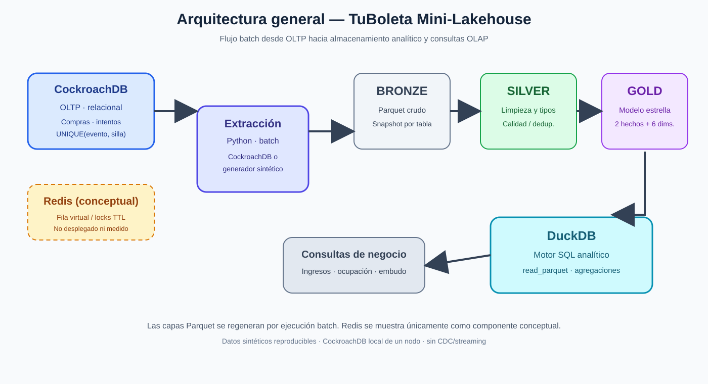

# Complemento documental de la entrega final

> Documento complementario del informe principal. Consolida los apartados de la plantilla que requerían mayor explicitud. Las afirmaciones distinguen entre funcionalidades implementadas, propuestas conceptuales y pruebas pendientes. No reemplaza las evidencias técnicas originales.

## 1. Implementación y estructura del repositorio

### 1.1 Árbol relevante

```text
tuboleta_lakehouse/
├── docker-compose.yml
├── main.py
├── requirements.txt
├── oltp/
│   ├── README.md
│   └── init/01_schema.sql
├── lakehouse/
│   ├── bronze/
│   ├── silver/
│   └── gold/
├── scripts/
│   ├── extract.py
│   ├── generate_synthetic.py
│   ├── transform_silver.py
│   ├── transform_gold.py
│   ├── analyze.py
│   ├── benchmark.py
│   ├── consultar.py
│   ├── oltp/
│   │   ├── load_cockroach.py
│   │   └── benchmark_cockroach.py
│   ├── taller4_optimizacion.py
│   ├── taller4_tipos.py
│   └── taller4_complementario.py
└── docs/
    ├── informe_final.md
    ├── informe_final.pdf
    ├── modelo_dimensional.png
    ├── reporte_calidad_silver.txt
    ├── resultados_consultas.md
    ├── entrega_final/
    └── taller4/
        └── planes/
```

Los directorios Bronze, Silver y Gold se versionan con archivos `.gitkeep`; los Parquet de ejecución se generan localmente y no se confunden con los archivos fuente del repositorio.

### 1.2 Scripts principales

| Script | Responsabilidad | Salida / verificación |
|---|---|---|
| `main.py` | Orquesta extracción, Silver, Gold, análisis y benchmark | Consola con estado y tiempos por etapa; código de salida distinto de cero ante error |
| `scripts/extract.py` | Genera datos sintéticos o extrae desde CockroachDB según `USE_SYNTHETIC` | Parquet Bronze por tabla y extracción |
| `scripts/generate_synthetic.py` | Genera el escenario reproducible y anomalías controladas | Datos de entrada para la ruta sintética |
| `scripts/transform_silver.py` | Deduplica, normaliza claves, corrige fechas, imputa canal y trata filas sin clave | Parquet Silver y reporte de calidad |
| `scripts/transform_gold.py` | Construye dimensiones, hechos, claves sustitutas y resolución SCD2 | Parquet Gold; validaciones de integridad |
| `scripts/analyze.py` | Ejecuta consultas de negocio y benchmark analítico | Resultados de consultas y mediciones |
| `scripts/consultar.py` | Ejecuta consultas SQL interactivas sobre Gold | Resultado y duración de la consulta |
| `scripts/oltp/load_cockroach.py` | Inicializa/carga el snapshot reproducible en CockroachDB | Esquema y datos OLTP locales |
| `scripts/oltp/benchmark_cockroach.py` | Mide lectura con/sin índice e impacto de inserciones | Resultados del laboratorio CockroachDB |
| `scripts/taller4_optimizacion.py` | Evalúa ordenamiento, data skipping, Hive y control ANALYZE | Planes y mediciones M4 |
| `scripts/taller4_tipos.py` | Compara fecha textual con TIMESTAMP | Planes y mediciones M4 |
| `scripts/taller4_complementario.py` | Ejecuta controles complementarios del laboratorio | Resultados complementarios en consola |

### 1.3 Ejecución reproducible

Desde la raíz del repositorio:

```powershell
git clone https://github.com/JPS4L4/tuboleta_lakehouse.git
cd tuboleta_lakehouse
python -m venv .venv
.venv\Scripts\Activate.ps1
pip install -r requirements.txt
python main.py
```

La ejecución por defecto utiliza datos sintéticos para que el pipeline analítico pueda reproducirse sin levantar CockroachDB. Para ejecutar el camino de extracción desde CockroachDB:

```powershell
docker compose up -d
python -m scripts.oltp.load_cockroach
$env:USE_SYNTHETIC = "false"
python main.py
```

Para volver a la ruta sintética en esa sesión de PowerShell:

```powershell
$env:USE_SYNTHETIC = "true"
python main.py
```

El tiempo de ejecución depende del equipo, el estado de Docker, la caché y la cantidad de datos generados; por eso no se fija un tiempo universal como requisito. La salida de cada ejecución es la referencia para informar el tiempo observado en el equipo de entrega.

## 2. Arquitectura general e integración



### 2.1 Responsabilidad de cada tecnología

| Tecnología | Modelo / rol | Carga | Estado real en el proyecto |
|---|---|---|---|
| CockroachDB v25.4.0 | Relacional transaccional | OLTP: compras, intentos e integridad | Implementado en Docker local de un nodo; snapshot sintético reproducible |
| Parquet | Formato columnar de archivos, no un servidor de base de datos | Persistencia analítica Bronze/Silver/Gold | Implementado |
| DuckDB 2.0.0 | Motor SQL analítico embebido | OLAP sobre Parquet | Implementado |
| Redis | Clave-valor en memoria | Propuesta de fila virtual y locks con TTL | No desplegado; componente conceptual, no evaluado experimentalmente |

La arquitectura es políglota en el sentido de que separa responsabilidades y modelos de persistencia. No se debe describir Redis como una base desplegada ni Parquet como un motor de base de datos. DuckDB es el motor analítico; Parquet es el formato de almacenamiento.

### 2.2 Justificación y alternativas

CockroachDB se eligió para la fuente operacional por su modelo relacional, transacciones y restricciones de integridad. La restricción única sobre evento y silla protege la regla de no vender dos veces el mismo asiento. PostgreSQL sería una alternativa relacional válida; no se realizó una prueba comparativa directa entre ambos, por lo que no se afirma superioridad de rendimiento.

DuckDB se eligió para OLAP porque consulta Parquet directamente y evita administrar un servidor analítico adicional en el entorno académico local. Spark sería una alternativa ante necesidades de procesamiento distribuido que no forman parte del alcance medido.

Parquet se prefirió sobre CSV como almacenamiento analítico porque es columnar, conserva tipos y habilita lectura selectiva y pruning por grupos/particiones. CSV sigue siendo útil para intercambio, pero no fue seleccionado como formato principal del lakehouse.

### 2.3 Integración, frecuencia y latencia

El patrón implementado es extracción batch desde CockroachDB (o generación sintética) hacia archivos Parquet. Bronze conserva el snapshot extraído; Silver aplica transformaciones técnicas; Gold construye el modelo dimensional; DuckDB consulta Gold.

No hay CDC ni streaming en la implementación. La actualización ocurre cuando se ejecuta manualmente el pipeline completo. La latencia de actualización es, por tanto, el tiempo de una corrida y no una latencia continua garantizada. El pipeline reconstruye las capas analíticas; no implementa cargas incrementales ni una marca de agua persistente.

## 3. Consultas, benchmark y dashboard

### 3.1 Consultas analíticas

El repositorio contiene nueve consultas de negocio ejecutadas por `scripts/analyze.py` y un documento de entrega con cinco consultas SQL completas, propósito y resultados de referencia: `docs/entrega_final/consultas_sql_resultados.md`. Las consultas cubren ingresos por canal, ocupación, embudo de conversión, evolución de precios SCD2 y análisis por evento/periodo.

Los resultados documentados corresponden a la ejecución de referencia indicada en cada archivo. Antes de reproducir la entrega en otro equipo, deben regenerarse Gold y ejecutarse las consultas para confirmar que los resultados coinciden con esa ejecución.

### 3.2 Alcance correcto del benchmark

La comparación SQLite vs. DuckDB del informe evalúa una consulta analítica equivalente sobre Silver/Parquet y Gold/Parquet. No es una comparación directa de CockroachDB contra DuckDB. El experimento de CockroachDB es independiente y evalúa el efecto de un índice compuesto en una tabla OLTP de laboratorio.

Por tanto, el resultado de 26,2x se debe expresar como: “DuckDB sobre Gold fue 26,2 veces más rápido que SQLite en la consulta, conjunto de datos y entorno documentados”. No se debe generalizar a toda carga ni atribuir exclusivamente al formato Parquet, porque también intervienen el modelo Gold, el motor y el paralelismo.

### 3.3 Dashboard

No se implementó un dashboard interactivo con Streamlit, Metabase u otra herramienta. La visualización de resultados se realiza mediante consultas SQL, salidas de consola y documentación. En consecuencia, la sección 5.3 de la plantilla se declara no aplicable al alcance implementado; no se adjuntan capturas ni se atribuyen KPIs a una interfaz inexistente. Como trabajo futuro, se propone un dashboard con ingresos, boletas, ocupación, ticket promedio y conversión por evento, zona, canal y periodo.

## 4. Metodología, diagnóstico y resultados M4

### 4.1 Protocolos realmente utilizados

Los protocolos no son idénticos entre todos los experimentos y deben mantenerse separados:

| Experimento | Calentamiento | Repeticiones reportadas | Métrica |
|---|---:|---:|---|
| Ordenamiento / Hive / control DuckDB | 3 warm-ups | 5 en el laboratorio principal | Mediana |
| Corrección VARCHAR → TIMESTAMP | Según script del experimento | 9 | Mediana |
| Lectura CockroachDB con/sin índice | Según script del laboratorio | 7 lecturas | Mediana |
| Inserción CockroachDB | Según script del laboratorio | 3 lotes | Mediana |

Los planes y perfiles están en `docs/taller4/planes/`. La guía `docs/entrega_final/estadistica_m4_reproducible.md` describe cómo ejecutar los scripts que exportan observaciones individuales y estadísticos.

Los históricos disponibles no contienen todas las observaciones crudas necesarias para reconstruir retrospectivamente mínimo, máximo y desviación estándar. No se inventan esos estadísticos. Para completar esa columna se deben ejecutar los comandos en el equipo de entrega y anexar los CSV resultantes. Las medianas históricas que ya están documentadas se conservan como resultados de sus corridas originales.

### 4.2 Comandos de medición

```powershell
python -m scripts.taller4_optimizacion
python -m scripts.taller4_tipos
docker compose up -d
python -m scripts.oltp.load_cockroach
python -m scripts.oltp.benchmark_cockroach
```

Los archivos esperados y el protocolo se detallan en `docs/entrega_final/estadistica_m4_reproducible.md`. No todos los comandos generan el mismo número de repeticiones ni deben combinarse sus resultados.

### 4.3 Resultados y lectura técnica

| Técnica | Antes | Después | Lectura |
|---|---:|---:|---|
| Ordenamiento / Q1 | 5,09 ms | 4,83 ms | 1,05x; bytes 640,9 → 142,4 kB; 3 de 11 row groups escaneados |
| Hive / Q2 | 2,31 ms | 2,55 ms | 0,91x; bytes 583,7 → 58,8 kB; se leyó 1 de 9 archivos, pero el overhead empeoró el tiempo |
| VARCHAR + CAST → TIMESTAMP | 19,887 ms | 4,996 ms | 3,98x; se preservó el resultado lógico |
| Índice CockroachDB | 687,713 ms | 331,261 ms | 2,08x en lectura; 163.137 frente a 1.000.000 filas decodificadas |
| Costo del índice en INSERT | 460,19 ms | 508,56 ms | 10,5 % más lento con índice |

La optimización Hive es un resultado negativo en tiempo de pared, aunque positivo en reducción de lectura. El particionamiento introduce costos de descubrimiento/listado de archivos y metadatos; con este volumen, esos costos superan el ahorro. El índice reduce el trabajo de lectura, pero encarece las escrituras porque debe mantenerse al insertar.

## 5. Lecciones aprendidas y trabajo futuro

### 5.1 Qué cambiaríamos del diseño original

1. **Ordenamiento como propiedad de Gold desde el primer diseño.** Ordenar la fact de ventas por `tiempo_sk` al materializar Gold permitiría que filtros temporales aprovechen row groups desde la primera versión, en lugar de aplicar el ordenamiento como experimento posterior.
2. **Tipos temporales correctos en la frontera de Silver.** La fecha debe convertirse a TIMESTAMP durante la estandarización y no esperar hasta la consulta analítica. Esto elimina CAST repetidos y reduce errores semánticos.
3. **Particionado condicionado por volumen y selectividad.** No activaríamos Hive automáticamente para cualquier tabla. La prueba mostró menos bytes leídos, pero peor tiempo total. Lo habilitaríamos cuando el volumen y la selectividad justifiquen el costo de metadatos, validándolo con benchmark.
4. **Índices guiados por consultas y costo de escritura.** Mantendríamos el índice compuesto solo si el patrón de lectura lo justifica. La mejora de lectura de 2,08x debe contrastarse con el aumento de 10,5 % en el lote de inserción.
5. **Separación explícita de datos de prueba y datos de negocio.** El benchmark de un millón de filas debe permanecer aislado de las tablas funcionales y claramente identificado como carga experimental.
6. **Automatizar validaciones y estadísticas.** El pipeline debería producir automáticamente conteos, aserciones, planes, muestras crudas y resumen estadístico por ejecución, con identificador de corrida y configuración registrada.

### 5.2 Limitaciones actuales

- Los datos son sintéticos y reproducibles; no representan ventas reales ni permiten inferir tasas comerciales reales.
- CockroachDB se ejecuta en un nodo local de Docker. No se evaluaron quorum, failover, latencia entre nodos ni recuperación ante particiones.
- Redis no está desplegado. La fila virtual y los locks TTL son parte del escenario conceptual y del generador, no una integración operacional probada.
- El pipeline es batch y reconstruye las capas; no implementa CDC, streaming ni cargas incrementales.
- El benchmark analítico compara SQLite con DuckDB y no sustituye una comparación CockroachDB vs DuckDB. Los motores también difieren en paralelismo.
- El máximo volumen sostenible no se ha determinado mediante una prueba de saturación. No se debe declarar una capacidad máxima sin medir memoria, duración y fallos a escala.
- Las mediciones son locales y sensibles a caché, carga del equipo, sistema operativo y versiones.

### 5.3 Evolución a 10x y 100x

**Escenario 10x.** Aumentarían la generación de datos y las pruebas de memoria/tiempo; introduciríamos cargas incrementales por fecha o watermark, compactación de archivos pequeños y particionamiento solo donde los filtros lo justifiquen. Mantendríamos DuckDB si el equipo y el tiempo de consulta siguen dentro de los objetivos medidos.

**Escenario 100x.** Evaluaríamos almacenamiento de objetos y un formato de tabla como Apache Iceberg o Delta Lake para snapshots, evolución de esquema y mantenimiento de metadatos. Para ingesta de baja latencia incorporaríamos CDC/changefeeds desde CockroachDB hacia Kafka y un consumidor de streaming (por ejemplo Flink) que escriba micro-lotes. La decisión dependería de SLO, volumen, concurrencia y costo operacional; no se justifica añadir esa infraestructura antes de necesitarla.

**Gobernanza.** Agregaríamos catálogo y linaje desde origen hasta Gold, contratos de esquema, controles de calidad automáticos, control de acceso por rol, gestión de secretos fuera del repositorio y retención/expiración documentada. Las métricas de calidad se monitorearían en cada corrida.

## 6. Trazabilidad M1 → M4

| Decisión de diseño | Módulo | Fundamento aplicado | Evidencia en el repositorio |
|---|---|---|---|
| Separación OLTP/OLAP y análisis CAP | M1 | Las cargas transaccionales priorizan consistencia de compra; la capa analítica admite procesamiento por lote y lecturas históricas | `docs/entrega_final/M1_contexto_requisitos.md`, `docs/informe_final.md` |
| Persistencia políglota: CockroachDB + Parquet + DuckDB; Redis conceptual | M2 | Elegir modelo según patrón de acceso; integridad relacional en OLTP y formato columnar + motor analítico para OLAP | `docs/entrega_final/M2_arquitectura_persistencia.md`, `oltp/init/01_schema.sql` |
| Modelo dimensional en estrella y granularidad de hechos | M3 | Separar procesos de ventas e intentos; dimensiones conformadas y métricas con granularidad explícita | `docs/diseno_dimensional.md`, `docs/modelo_dimensional.png` |
| SCD Tipo 2 en dimensión de zona | M3 | Preservar versiones históricas de atributos que cambian y resolver vigencia por fecha del hecho | `docs/informe_final.md`, `docs/entrega_final/consultas_sql_resultados.md` |
| Ordenamiento, Hive, TIMESTAMP e índice compuesto | M4 | Diagnóstico basado en planes, intervención aislada y medición de beneficios/costos | `docs/entrega_final/M4_optimizacion_rendimiento.md`, `docs/taller4/planes/` |

## 7. Anexos y referencias exactas

| Evidencia | Ruta |
|---|---|
| Repositorio y ejecución | [GitHub — rama entrega-final](https://github.com/JPS4L4/tuboleta_lakehouse/tree/entrega-final) |
| Informe principal | `docs/informe_final.md` y `docs/informe_final.pdf` |
| Contexto y requisitos M1 | `docs/entrega_final/M1_contexto_requisitos.md` |
| Arquitectura M2 | `docs/entrega_final/M2_arquitectura_persistencia.md` |
| Modelo dimensional | `docs/modelo_dimensional.png` y `docs/modelo_dimensional.dbml` |
| Calidad Silver | `docs/reporte_calidad_silver.txt` |
| Cinco consultas SQL de entrega | `docs/entrega_final/consultas_sql_resultados.md` |
| Diagnóstico y optimización M4 | `docs/entrega_final/M4_optimizacion_rendimiento.md` |
| Estadística reproducible M4 | `docs/entrega_final/estadistica_m4_reproducible.md` |
| Planes DuckDB antes/después | `docs/taller4/planes/Q1_antes.txt`, `Q1_despues.txt`, `Q2_antes.txt`, `Q2_despues.txt`, `Q3_antes.txt`, `Q3_despues.txt` |
| Planes CockroachDB | `docs/taller4/planes/cockroach_Q1_antes_full_scan.txt`, `cockroach_Q1_despues_index_scan.txt` |

## 8. Lista de verificación de entrega

- [x] Repositorio y rama de entrega identificados.
- [x] Informe principal y documentos M1/M2/M4 presentes.
- [x] Cinco consultas SQL de entrega documentadas.
- [x] Reporte de calidad Silver presente.
- [x] Diagrama dimensional PNG presente.
- [x] Planes de ejecución antes/después presentes en `docs/taller4/planes/`.
- [x] Resultados históricos de benchmarks y limitaciones descritos.
- [x] Dashboard no implementado: declarado explícitamente, sin evidencia ficticia.
- [ ] Ejecutar `python main.py` en el equipo de entrega y conservar la salida final.
- [ ] Ejecutar los tres laboratorios estadísticos y anexar `mediciones_crudas_*.csv` y `estadisticas_*.csv`; no reconstruir estadísticos desde medianas.
- [ ] Regenerar `docs/informe_final.pdf` después de integrar la versión final del informe y comprobar el número de páginas.
- [ ] Confirmar que la rama/repositorio sea accesible para el docente.

Los puntos sin marcar requieren ejecución o verificación en el equipo local y no pueden certificarse desde la documentación del repositorio.
