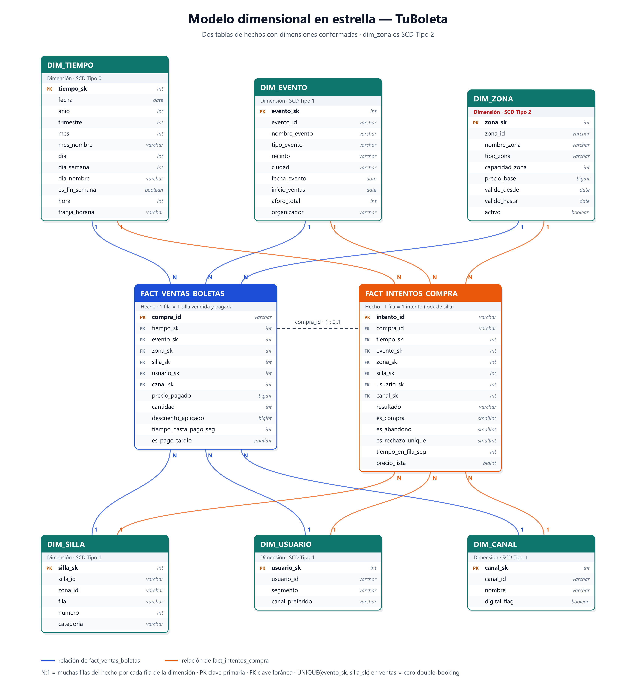

# TuBoleta Mini-Lakehouse

**Guía para entender, instalar y presentar el proyecto**

| Campo | Detalle |
|---|---|
| Proyecto | Mini-Lakehouse Bronze / Silver / Gold con Parquet y DuckDB para analizar la venta de boletería del Estadio Atanasio Girardot |
| Cursos | Tópicos Avanzados en Bases de Datos, Talleres 3 y 4 y entrega final |
| Integrantes | Luis Manuel Contreras · Juan Pablo Salazar |
| Docente | Roberto Carlos Rahamut Suteu · ITM, Medellín 2026 |
| Repositorio | github.com/JPS4L4/tuboleta_lakehouse |
| Para qué sirve | Entender el proyecto de punta a punta, instalarlo, y tener el guion base de las diapositivas |

Esta guía se escribió leyendo el repositorio publicado (código, documentos y resultados). Las cifras salen de los archivos del repo y corresponden a la corrida final del 26-11-2026; cuando varían entre ejecuciones se indica.

# 1. ¿Qué es este proyecto? {.salto}

Es una capa analítica para una empresa de boletería (TuBoleta). Toma los datos que genera el sistema de ventas, los limpia, los organiza en un modelo pensado para análisis y responde preguntas de negocio: cuánto se vendió, cómo terminan los intentos de compra y cómo cambió el precio.

Todo se ejecuta con un solo comando (`python main.py`), en pocos segundos (6,92 s en la corrida final), y por defecto no necesita levantar ninguna base de datos.

## Las dos preguntas de negocio que modela

- **Ventas:** cuántas boletas y cuánto dinero por evento, zona, canal y período. Una fila = una silla vendida y pagada.
- **Embudo de compra:** cómo terminan los intentos (compra, abandono o rechazo por `UNIQUE`). Una fila = un intento.

## Glosario mínimo (para no perderse en la exposición)

| Término | Qué significa aquí |
|---|---|
| Lakehouse | Datos en archivos abiertos (Parquet) organizados por capas, consultables con SQL. Mezcla la flexibilidad de un data lake con el orden de un data warehouse. |
| Bronze / Silver / Gold | Tres capas de calidad creciente. Bronze: dato crudo tal cual llega. Silver: limpio y tipado. Gold: modelado para análisis. |
| Parquet | Formato de archivo columnar y comprimido. Guarda mínimo y máximo por bloque (row group), lo que permite saltarse bloques al filtrar. |
| DuckDB | Motor SQL analítico que corre dentro del proceso de Python y lee Parquet directamente. No hay servidor que instalar. |
| Modelo en estrella | Tablas de hechos (eventos medibles) rodeadas de dimensiones (el contexto: tiempo, evento, zona, canal...). |
| SCD Tipo 2 | Técnica para guardar el historial de una dimensión. Aquí: `dim_zona` conserva el precio antes y después del 2026-07-01. |
| OLTP vs OLAP | OLTP: sistema transaccional que vende (Redis + CockroachDB). OLAP: sistema que analiza (este lakehouse). |
| EXPLAIN ANALYZE | Comando que muestra el plan de ejecución de una consulta. Es la base del Taller 4. |

# 2. Arquitectura: qué es real y qué es simulado

Este es el punto que más conviene tener claro, porque es el que generó el reclamo del docente. DuckDB y Parquet no reemplazan a CockroachDB y Redis: cumplen otro rol. CockroachDB y Redis son el sistema operacional (venden boletas). El lakehouse es la capa analítica que se alimenta de él.

| Capa | Componentes | Detalle |
|---|---|---|
| Sistema operacional (OLTP) | CockroachDB (CP): compras, `UNIQUE`, `SERIALIZABLE`. Redis (AP): fila virtual, locks con TTL | Redis es estado efímero: no se extrae a Bronze |
| Extracción | `extract.py` | Por lote. Con `USE_SYNTHETIC=true` la reemplaza `generate_synthetic.py`; con `false` lee las siete tablas de CockroachDB |
| Capa analítica (lakehouse) | Bronze (Parquet crudo) → Silver (limpio y tipado) → Gold (estrella + SCD2) | `transform_silver.py` y `transform_gold.py` |
| Consulta | DuckDB sobre Gold (`read_parquet`) | `analyze.py` (nueve consultas y benchmark) y `consultar.py` |

El diagrama gráfico está en `docs/entrega_final/arquitectura_general.svg` y el diagrama de flujo en el informe final.

| Componente | En producción (caso real) | En este proyecto | Dónde está en el código |
|---|---|---|---|
| Redis | Fila virtual, locks con TTL de 600 s, contadores. Estado efímero. | No se ejecuta. Su efecto aparece como el TTL y los abandonos del generador. | `config.py` (`TTL_LOCK_SEG`), `generate_synthetic.py` |
| CockroachDB | Fuente de verdad. `UNIQUE(evento, silla)` bajo `SERIALIZABLE` evita el double-booking. | Laboratorio local de un nodo en Docker (v25.4.0) con el snapshot sintético cargado por `load_cockroach.py`. La extracción real se corrió con `USE_SYNTHETIC=false`. | `docker-compose.yml`, `oltp/`, `scripts/oltp/`, `extract.py` (`USE_SYNTHETIC`, `DB_URL`) |
| Parquet + DuckDB | Capa analítica y de consulta (también podrían ser ClickHouse, BigQuery, etc.). | Es lo que se ejecuta de verdad: Bronze, Silver, Gold, consultas y Taller 4. | `transform_*.py`, `analyze.py`, `consultar.py` |

**Cómo decirlo en una frase:** «El sistema que vende es CockroachDB con Redis; el lakehouse con Parquet y DuckDB es donde se analiza lo que ese sistema vendió. En el proyecto, CockroachDB corre como laboratorio local con un snapshot sintético y el pipeline lo extrae de verdad; el modo sintético directo sigue disponible para reproducir todo sin infraestructura».

**Lo que hay que reconocer:** CockroachDB corre en un solo nodo local y con datos sintéticos, así que no se evaluaron quórum, failover ni rendimiento distribuido. Redis sigue sin código: no hay servicio en `docker-compose.yml` ni operaciones `SET NX EX`; su efecto aparece en el generador. Está declarado en las limitaciones del README y del informe final.

# 3. Cómo instalarlo y ejecutarlo

## Requisitos

- **Python:** 3.10 o superior para el pipeline (probado con 3.12). Los tiempos del Taller 4 se midieron con Python 3.14 y las versiones fijadas en `requirements.txt`.
- Git para clonar el repositorio.
- Por defecto no necesita CockroachDB, Redis ni Docker: genera datos sintéticos. Docker solo se usa para el laboratorio CockroachDB.
- Solo para generar PDF (informes y esta guía): Microsoft Edge o Google Chrome instalado.

## Paso a paso (Windows)

```
git clone https://github.com/JPS4L4/tuboleta_lakehouse.git
cd tuboleta_lakehouse
python -m venv .venv
.venv\Scripts\activate
pip install -r requirements.txt
python main.py
```

En Linux o macOS la activación del entorno es `source .venv/bin/activate`. Si PowerShell bloquea la activación, ejecute una vez `Set-ExecutionPolicy -Scope CurrentUser RemoteSigned`.

## ¿Cómo sé que funcionó?

- La terminal muestra los 4 pasos (extracción, Silver, Gold, análisis) y un resumen de tiempos; el código de salida es 0.
- Aparecen 8 archivos Parquet en `lakehouse/gold/` (2 hechos y 6 dimensiones).
- Se regeneran `docs/resultados_consultas.md`, `docs/benchmark.md` y `docs/reporte_calidad_silver.txt`.

## Comandos útiles

| Qué quiero hacer | Comando |
|---|---|
| Correr todo el pipeline | `python main.py` |
| Correr un solo paso | `python -m scripts.transform_silver` (también `extract`, `transform_gold`, `analyze`) |
| Ver consultas listas | `python -m scripts.consultar --lista` |
| Ejecutar una consulta lista | `python -m scripts.consultar ocupacion` (también `embudo`, `vip`, `canales`) |
| Escribir una consulta SQL propia | `python -m scripts.consultar "SELECT ... FROM fact_ventas_boletas ..."` |
| Taller 4: planes, intervenciones y benchmarks | `python -m scripts.taller4_optimizacion` |
| Taller 4: corrección de tipos | `python -m scripts.taller4_tipos` |
| Taller 4: controles complementarios | `python -m scripts.taller4_complementario` |
| Taller 4: generar el PDF del informe | `python -m scripts.taller4_pdf` (requiere Edge o Chrome) |
| Informe final y esta guía: generar los PDF | `python -m scripts.entrega_pdf` (requiere Edge o Chrome) |

## Usar CockroachDB real (laboratorio local)

```
docker compose up -d
python -m scripts.oltp.load_cockroach
$env:USE_SYNTHETIC="false"      # PowerShell
python main.py
python -m scripts.oltp.benchmark_cockroach
```

Esta es la ruta con la que se hizo la corrida final del 26-11-2026. Las tablas se llaman `zonas`, `eventos`, `sillas`, `usuarios`, `canales`, `compras_confirmadas` e `intentos_compra` y tienen las mismas columnas que Bronze; `DB_URL` por defecto es `postgresql://root@localhost:26257/tuboleta?sslmode=disable`. Para volver a la ruta sintética: `$env:USE_SYNTHETIC="true"`.

## Errores frecuentes

| Síntoma | Causa probable | Solución |
|---|---|---|
| `ModuleNotFoundError` | El entorno virtual no está activo o faltó `pip install` | Activar `.venv` y repetir `pip install -r requirements.txt` |
| `No module named scripts` | Se ejecutó `python scripts/x.py` | Usar `python -m scripts.x` desde la raíz del repo |
| `consultar.py` no encuentra tablas | Aún no se generó Gold | Ejecutar `python main.py` primero |
| Falla al instalar paquetes | Versión de Python distinta a la fijada | Usar Python 3.14 o ajustar versiones en `requirements.txt` |
| Error al generar un PDF | No hay Edge ni Chrome instalados | Instalar uno de los dos o usar el PDF ya generado |
| Falla la extracción con `USE_SYNTHETIC=false` | CockroachDB no está levantado o las tablas no están cargadas | `docker compose up -d` y `python -m scripts.oltp.load_cockroach` |
| Tiempos distintos a los del informe | Otra máquina o carga del sistema | Es normal; lo comparable son filas, bytes y operadores del plan |

# 4. Qué hay en el repositorio

| Ruta | Para qué sirve |
|---|---|
| `main.py` | Orquestador: extract → Silver → Gold → analyze. Imprime tiempos y termina con código 1 si algo falla. |
| `requirements.txt` | Versiones fijadas: duckdb 2.0.0, pandas 3.1.0, pyarrow 26.0.1, numpy 2.5.4, sqlalchemy 2.1.6, psycopg2-binary 2.9.13. |
| `scripts/config.py` | Rutas, semilla (42), TTL del lock (600 s), volúmenes y variables `USE_SYNTHETIC` y `DB_URL`. |
| `scripts/generate_synthetic.py` | Simula el sistema operacional: 4 zonas, 45.000 sillas, 5 eventos, 150.000 usuarios y la «suciedad» intencional. |
| `scripts/extract.py` | Fuente (sintética o CockroachDB) → Bronze, con columnas de trazabilidad `_extraido_en` y `_fuente`. |
| `scripts/transform_silver.py` | Bronze → Silver: deduplica, normaliza IDs, convierte tipos, trata nulos. Escribe el reporte de calidad. |
| `scripts/transform_gold.py` | Silver → Gold: dimensiones, claves sustitutas, SCD Tipo 2 y verificaciones con assert. |
| `scripts/analyze.py` | Nueve consultas de negocio y el benchmark. Escribe los resultados en `docs/`. |
| `scripts/benchmark.py` | Compara SQLite (por filas), DuckDB sobre Bronze y DuckDB sobre Gold. |
| `scripts/consultar.py` | Consultas en vivo sobre Gold para la exposición. |
| `scripts/oltp/` | Laboratorio CockroachDB: `load_cockroach.py` carga el snapshot y `benchmark_cockroach.py` mide el índice compuesto. |
| `scripts/taller4_*.py` | Taller 4: optimización, tipos, controles complementarios y PDF del informe. |
| `scripts/entrega_pdf.py` | Genera `informe_final.pdf` y `guia_proyecto.pdf` desde sus fuentes Markdown. |
| `docker-compose.yml`, `oltp/` | Nodo local de CockroachDB, esquema y guía del motor transaccional. |
| `lakehouse/` | Bronze, Silver y Gold en Parquet. No se versionan: se regeneran en cada ejecución. |
| `docs/` | Diseño dimensional, modelo (`.dbml` y `.png`), reportes, informe final y esta guía (fuente `.md` y `.pdf`), y paquete de entregables. |
| `docs/entrega_final/` | Documentos por módulo (M1, M2, M4), consultas SQL con resultados, estadística reproducible, matriz de cumplimiento, complemento documental y diagrama de arquitectura. |
| `docs/taller4/` | Diagnóstico, intervenciones, benchmarks, seis CSV de mediciones y estadísticos, análisis complementario, informe (md y pdf) y planes EXPLAIN. |

# 5. El pipeline capa por capa

| Capa | Qué contiene | Qué se le hace |
|---|---|---|
| Bronze | Parquet crudo, versionado por extracción (`tabla_AAAAMMDD_HHMM.parquet`). | Solo se copia la fuente y se agrega trazabilidad. No se limpia nada. |
| Silver | Parquet limpio y tipado. | Deduplica por clave de negocio (~1 % duplicados), quita espacios en IDs (~1,5 %), convierte fechas de texto, reemplaza canal nulo por `DESCONOCIDO` (~1,5 %) y descarta 40 filas sin clave. |
| Gold | 2 hechos + 6 dimensiones en estrella. | Crea claves sustitutas, resuelve la versión de zona vigente por fecha y verifica reglas con assert (cero double-booking, una versión de zona por fila). |

La «suciedad» no es un error: en modo sintético directo se inyecta a propósito en Bronze para que Silver tenga trabajo real y se pueda demostrar la calidad de datos. Las dos rutas no deben confundirse: en modo CockroachDB (`USE_SYNTHETIC=false`) la extracción refleja lo almacenado. En la corrida final (26-11-2026 16:40) Bronze y Silver conservaron las 208.236 compras y los 260.294 intentos, con 3.101 NULL de `canal_id` en compras y 3.906 en intentos imputados como `DESCONOCIDO`; las cifras de duplicados y filas sin clave corresponden a la ruta sintética. El detalle de cada ejecución queda en `docs/reporte_calidad_silver.txt` y `docs/taller4/ejecuciones_pipeline.md`.

# 6. El modelo dimensional

Diagrama en estrella generado desde `docs/modelo_dimensional.dbml` (se abre en dbdiagram.io).



## Decisiones de diseño que hay que saber defender

| Decisión | Por qué |
|---|---|
| Dos tablas de hechos | Los abandonos no son ventas. Mezclarlos obligaría a filtrar en cada SUM y bastaría un olvido para inflar los ingresos. `fact_ventas_boletas` (una fila = silla vendida) y `fact_intentos_compra` (una fila = intento). |
| SCD Tipo 2 solo en `dim_zona` | Es la única dimensión cuyo cambio altera el significado de las métricas: el precio cambió el 2026-07-01 (VIP 250.000 → 280.000; Occidental 150.000 → 165.000). Sin SCD2 se perdería o reescribiría la historia. |
| `dim_tiempo` por hora, clave AAAAMMDDHH | En boletería importa la hora (pico nocturno, apertura de ventas). El entero conserva el orden cronológico, lo que permite filtrar rangos directo en la fact. |
| Redis no es un hecho | Fila virtual y locks vivos son estado efímero, no durable ni reconstruible. Sí es un hecho el resultado persistido de cada intento. |
| Dimensiones conformadas | Ambas facts comparten las mismas seis dimensiones, así que ventas y embudo se pueden cruzar con los mismos filtros. |
| Análisis por zona agrupan por `zona_id` | Nunca por versión ni con `activo = true`; si no, se descartarían las ventas anteriores al cambio de precio. |

## Métricas de cada hecho

| Hecho | Métricas aditivas | No aditivas y flags |
|---|---|---|
| `fact_ventas_boletas` | `precio_pagado`, `cantidad`, `descuento_aplicado` | `tiempo_hasta_pago_seg` (solo AVG o percentiles); `es_pago_tardio` (pago en el último 20 % del TTL, sigue siendo venta válida) |
| `fact_intentos_compra` | `precio_lista` (con abandono estima ingreso perdido) | `resultado`; `es_compra`, `es_abandono`, `es_rechazo_unique`; `tiempo_en_fila_seg` |

# 7. Qué tenemos hoy: resultados

## Taller 3: pipeline y análisis

| Tabla | Filas |
|---|---:|
| Ventas confirmadas (`fact_ventas_boletas`) | 208.236 |
| Intentos de compra (`fact_intentos_compra`) | 260.294 (+25 % sobre las ventas) |
| Sillas / usuarios | 45.000 / 150.000 |
| Eventos / versiones de zona | 5 / 6 |
| `dim_tiempo` (granularidad de hora) | 5.656 |

## Hallazgos de negocio (datos sintéticos)

- **Ingresos:** 22.126 millones de COP con 208.236 boletas. Canal app 44 %, web 39 %, taquilla 15 %, sin canal 1,5 %.
- **Ocupación:** entre 85,8 % y 100 %; el Clásico Paisa agotó VIP y Occidental.
- **Embudo:** de cada 100 intentos, ~80 terminan en compra, ~14 en abandono y ~6 en rechazo `UNIQUE`. Estas tasas salen de los parámetros del generador, no son reales.
- **SCD2 en VIP:** con el precio de 250.000 se vendieron 5.834 boletas (1.412 millones de COP); con 280.000, 8.041 (2.187 millones de COP).
- **Horarios:** tarde y noche concentran ~70 % de las ventas; el primer día de cada evento, ~10 %.
- **Abandono:** 3.868 millones de COP de precio de lista (cota superior del ingreso potencial perdido).

## Benchmark: almacén por filas vs columnar

Agregación: boletas e ingresos por evento x zona x mes (60 grupos, 208.236 ventas); calentamiento y mediana de 5 corridas.

| Motor | Fuente | Mediana (ms) | Mejora |
|---|---|---:|---:|
| (a) SQLite, por filas | Silver normalizado + índices | 287,29 | 1,0x |
| (b) DuckDB sobre Bronze | Parquet sucio, limpia en la consulta | 112,38 | 2,6x |
| (c) DuckDB sobre Gold | Parquet columnar modelado | 10,12 | 28,4x |

Las cifras son las de `docs/benchmark.md` (26-11-2026 16:40, 12 hilos lógicos). Gold fue unas 11 veces más rápido que Bronze: el modelado evita limpiar al vuelo y usa claves enteras y dimensiones pequeñas. La comparación no es perfecta: DuckDB usa varios hilos y SQLite uno solo, y SQLite no es CockroachDB, así que no es una comparación OLTP real contra OLAP.

# 8. Taller 4: optimización de consultas

Pregunta guía: si tengo una consulta lenta, ¿qué puedo hacer al respecto? El método es leer el plan de ejecución, nombrar el problema con vocabulario preciso, aplicar una intervención por problema y medir antes y después (warm-up ×3, mediana de 5). Cifras de la corrida final del 26-11-2026, con CSV crudos y estadísticos en `docs/taller4/`.

| Query | Problema diagnosticado | Intervención | Antes | Desp. | Factor | Cambio en el plan |
|---|---|---|---:|---:|---:|---|
| Q1 Ingresos por evento, sep-2026 | Acceso secuencial sin data skipping (1 row group) | I-3: ordenar por `tiempo_sk` | 4,97 ms | 5,02 ms | 0,99x | Row groups 1/1 → 3/11; 261,1 → 142,4 kB |
| Q2 Ingresos por zona, sep-2026 | Acceso secuencial sobre archivo único | I-6: particionado Hive year/month | 2,44 ms | 3,14 ms | 0,78x | Archivos 1/9; 246,3 → 58,8 kB |
| Q3 Embudo de conversión | Ninguno (agregación total sin filtro) | I-2: ANALYZE (control) | 2,65 ms | 2,69 ms | 0,98x | Plan idéntico |
| Fecha como VARCHAR | CAST por fila sobre texto | VARCHAR + CAST → TIMESTAMP | 14,338 ms | 4,285 ms | 3,35x | Mismos 34.039 registros y COP 3.689.715.500 |
| CockroachDB: lectura | Full scan de 1.000.000 de filas (tabla experimental) | Índice compuesto `(tiempo_sk, evento_sk)` | 426,217 ms | 210,591 ms | 2,02x | Filas decodificadas 1.000.000 → 164.066 |
| CockroachDB: INSERT de 20.000 filas | Costo de escritura del índice | (medición del costo) | 308,35 ms | 358,24 ms | 1,16x de costo | El índice añade ~16,2 % a la escritura |

El plan de CockroachDB sin índice registró 1.000.000 de filas, 73 MiB y ocho llamadas gRPC; con índice, 164.066 filas, 9,7 MiB y una llamada. Los tiempos de EXPLAIN ANALYZE (732 ms y 241 ms) son capturas instrumentadas individuales, distintas de las medianas de siete corridas.

## Lo que significa

- Las intervenciones sí funcionaron sobre el acceso: el motor leyó 1,8x y 4,2x menos datos (Q1 y Q2).
- Pero el tiempo no mejoró: con ~200.000 filas cada consulta tarda 2 a 5 ms, y en Q1 la diferencia de medianas (0,05 ms) es menor que la desviación estándar (0,18 y 0,28 ms). Con 1 hilo, el efecto aislado de I-3 es de 4,45 a 4,41 ms (1,01x); fuera de los operadores quedan unos 2,5 ms de costo fijo del motor (planificar, abrir archivos).
- En Q1, el paralelismo de 11 row groups cuesta más de lo que ahorra a esta escala: la CPU sumada sube de 1,61 a 7,25 ms.
- En Q2, listar y parsear las carpetas Hive se come la ganancia: el glob Hive midió 2,76 ms, frente a 1,81 ms del archivo único y 1,26 ms de leer directamente la partición de septiembre. Además el planner pierde estadísticas (estima 1 fila en vez de 34.039).
- Q3 es un experimento de control: `ANALYZE` no cambia nada porque las estimaciones ya eran exactas. Un resultado nulo con explicación correcta es válido según el enunciado.
- El error de estimación de Q1 (1.651 filas estimadas frente a 34.039 reales, 20,6x) viene de leer Parquet por vistas, no de estadísticas viejas: `ANALYZE` lo deja igual (1.651 → 1.651) y lo mejora materializar la tabla.
- Las dos intervenciones con ganancia de tiempo clara son la corrección de tipos (3,35x) y el índice en CockroachDB (2,02x en lectura), este último a costa de 16,2 % más en escritura.

## Reflexión arquitectural (qué cambiaríamos)

- Ordenar el Gold por fecha y fijar el `row_group_size` debe ser parte de `transform_gold.py` desde el inicio.
- Convertir la fecha a TIMESTAMP en la frontera de Silver, no en la consulta.
- Particionar solo cuando el volumen y la selectividad lo justifiquen; con este volumen, Hive redujo bytes pero empeoró el tiempo.
- Mantener el índice compuesto solo si el patrón de lectura justifica el costo de escritura.
- Las agregaciones totales se resuelven con vistas materializadas o pre-agregaciones, no con índices.
- Siguiente experimento: subir `N_USUARIOS` en `config.py` y repetir para ver dónde I-3 e I-6 se vuelven decisivas.

# 9. Estado actual, limitaciones y pendientes

| Área | Estado |
|---|---|
| Pipeline Bronze → Silver → Gold | Completo y reproducible con un comando (corrida final 26-11-2026: 6,92 s, `USE_SYNTHETIC=false`) |
| Modelo dimensional, SCD2 y verificaciones | Completo, con diagrama y documento de diseño |
| Análisis y benchmark (Taller 3) | Completo; README e informe con las cifras de la corrida final |
| Taller 4: diagnóstico, intervenciones, informe | Completo; seis CSV de mediciones y estadísticos, planes EXPLAIN y PDF regenerados |
| Laboratorio CockroachDB | Probado: nodo local Docker, carga del snapshot, extracción con `USE_SYNTHETIC=false` y benchmark de índice (un nodo, datos sintéticos) |
| Redis | Solo documentado; no hay código ni demo |
| Cargas incrementales / CDC | No implementado (carga completa cada vez) |
| Dashboard | No implementado; declarado como no aplicable |

## Pendientes

- Verificar el contenido del ZIP final (`docs/entregables_tuboleta_lakehouse.zip`) y que incluya los archivos que se van a entregar.
- Confirmar que el docente tenga acceso al repositorio (repositorio público o acceso compartido).

## Limitaciones que deben declararse en la sustentación

- Los datos son sintéticos; no son transacciones reales de TuBoleta.
- CockroachDB se probó en un nodo local Docker, no en un clúster distribuido.
- La tabla de un millón de filas pertenece al benchmark experimental del índice y está separada de las tablas funcionales del lakehouse.
- Redis se describe como componente conceptual; no está desplegado.
- El pipeline es batch; no implementa CDC ni streaming.
- Las mediciones dependen del equipo, versión, caché y carga del sistema. No son garantías de rendimiento en producción.

# 10. Cómo evitar otro reclamo sobre CockroachDB vs DuckDB

El docente reaccionó a un cambio de motor. La causa de fondo era que el proyecto no dejaba claro qué parte es el sistema real y cuál la simulación. Estas son las acciones, de menor a mayor esfuerzo, con su estado actual:

| # | Acción | Esfuerzo | Estado |
|---|---|---|---|
| 1 | Preguntar y dejar por escrito (correo o acta) qué motor espera el docente para cada taller y si DuckDB es aceptable como motor de consulta. | Bajo | Pendiente: es una gestión fuera del repositorio |
| 2 | Poner en la primera página del README y del informe una tabla «Real vs simulado» y la frase de la sección 2. | Bajo | Hecho: el README abre con la tabla «Alcance: qué es real y qué es simulado» y el informe lo declara en el contexto y la arquitectura |
| 3 | Probar la rama CockroachDB: levantar un nodo con Docker, cargar los datos sintéticos con un script y correr `USE_SYNTHETIC=false`. | Medio | Hecho: `docker compose up -d`, `load_cockroach.py` y corrida final del 26-11-2026 con `USE_SYNTHETIC=false` |
| 4 | Para el Taller 4, correr EXPLAIN ANALYZE también en CockroachDB. | Medio | Hecho sobre una tabla experimental de 1.000.000 de filas (índice compuesto, 2,02x), con planes antes y después; no sobre `fact_ventas_boletas`, que vive en Parquet |
| 5 | Mini-demo de Redis: un script que haga `SET NX EX 600` y muestre el lock expirar. | Bajo | No hecho: Redis queda como componente conceptual |
| 6 | Hacer del motor una opción de configuración, no una sustitución: mismo pipeline, variable `USE_SYNTHETIC` claramente documentada. | Medio | Hecho: `USE_SYNTHETIC` y `DB_URL` están documentadas en el README |

Lo que más pesa frente al docente es lo que ya está hecho (2, 3, 4 y 6). Quedan por cerrar la 1 (por escrito) y, si hay tiempo, la 5.

# 11. Propuesta de diapositivas {.salto}

Doce diapositivas para unos 12 a 15 minutos. Cada una tiene un mensaje central; el resto es apoyo visual.

| # | Título | Mensaje central | Qué mostrar |
|---|---|---|---|
| 1 | Portada | TuBoleta Mini-Lakehouse: de la venta a la decisión | Título, integrantes, docente |
| 2 | El problema | Vender boletas masivas y no saber qué pasó con cada intento | Dos preguntas de negocio: ventas y embudo |
| 3 | Arquitectura real vs taller | El lakehouse es la capa analítica; CockroachDB y Redis siguen siendo el sistema que vende | `arquitectura_general.svg` + tabla real/simulado |
| 4 | Pipeline Bronze → Silver → Gold | Cada capa tiene una responsabilidad | Flujo con una línea por capa |
| 5 | Datos sucios a propósito | Silver demuestra calidad de datos | Tabla de problemas inyectados y reporte de calidad |
| 6 | Modelo en estrella | Dos hechos, seis dimensiones conformadas | `modelo_dimensional.png` |
| 7 | SCD Tipo 2 | El precio cambió el 1-jul y no perdimos la historia | Tabla `dim_zona` con 2 versiones de VIP + cifras 5.834 vs 8.041 |
| 8 | Resultados de negocio | Qué responde el análisis | 3 o 4 cifras: 22.126 M COP, embudo 80/14/6, ocupación |
| 9 | Benchmark | Columnar y modelado vs almacén por filas | Gráfico de barras 287 / 112 / 10 ms, con la salvedad de hilos |
| 10 | Taller 4: método | Leer el plan, nombrar el problema, una intervención, medir | Ciclo de 4 pasos + ejemplo de plan de Q1 |
| 11 | Taller 4: resultados | Leímos 1,8x y 4,2x menos datos pero el tiempo no mejoró, y sabemos por qué; tipos 3,35x e índice 2,02x sí | Tabla de benchmarks con row groups, archivos y bytes |
| 12 | Qué cambiaríamos y siguientes pasos | Ordenar en el pipeline, escalar datos, evolucionar a 10x y 100x | Reflexión arquitectural y pendientes |

## Consejos de exposición

- Abrir con la diapositiva 3: despeja de entrada la duda de motores.
- En el Taller 4, vender el hallazgo, no el factor: «redujimos 1,8x y 4,2x los datos leídos» y «explicamos por qué no se vio en milisegundos».
- Tener a mano una demo en vivo: `python -m scripts.consultar ocupacion` y `vip`.

## Preguntas probables y respuesta corta

| Pregunta | Respuesta sugerida |
|---|---|
| ¿Por qué DuckDB y no CockroachDB? | CockroachDB es el sistema operacional y se usa como fuente (laboratorio local, `USE_SYNTHETIC=false`). DuckDB es el motor analítico sobre Parquet, que es otra capa. |
| ¿Dónde queda Redis? | Es estado efímero y no es un hecho analítico; su efecto aparece como TTL, abandonos y tiempo hasta el pago. No está desplegado. |
| ¿Qué haría en producción? | Extraer de CockroachDB con changefeeds (CDC) a Bronze, cargas incrementales y el mismo modelo en estrella. |
| ¿Por qué las optimizaciones no mejoraron el tiempo? | El dataset es pequeño: hay un costo fijo del motor de unos 2,5 ms. Lo medimos con controles. El beneficio crece con el volumen. |
| ¿Por qué dos tablas de hechos? | Para que ningún SUM de ingresos incluya abandonos por error. |
| ¿Los datos son reales? | No: son sintéticos y deterministas (semilla 42). Las tasas de conversión son parámetros del generador. |
| ¿Por qué ANALYZE no se aplicó primero? | Las consultas leen vistas sobre Parquet, que no tienen estadísticas propias; se probó y no movió la estimación. |
| ¿Es CockroachDB contra DuckDB el benchmark del pipeline? | No: compara SQLite con DuckDB. El experimento de CockroachDB es aparte y mide el efecto de un índice. |
