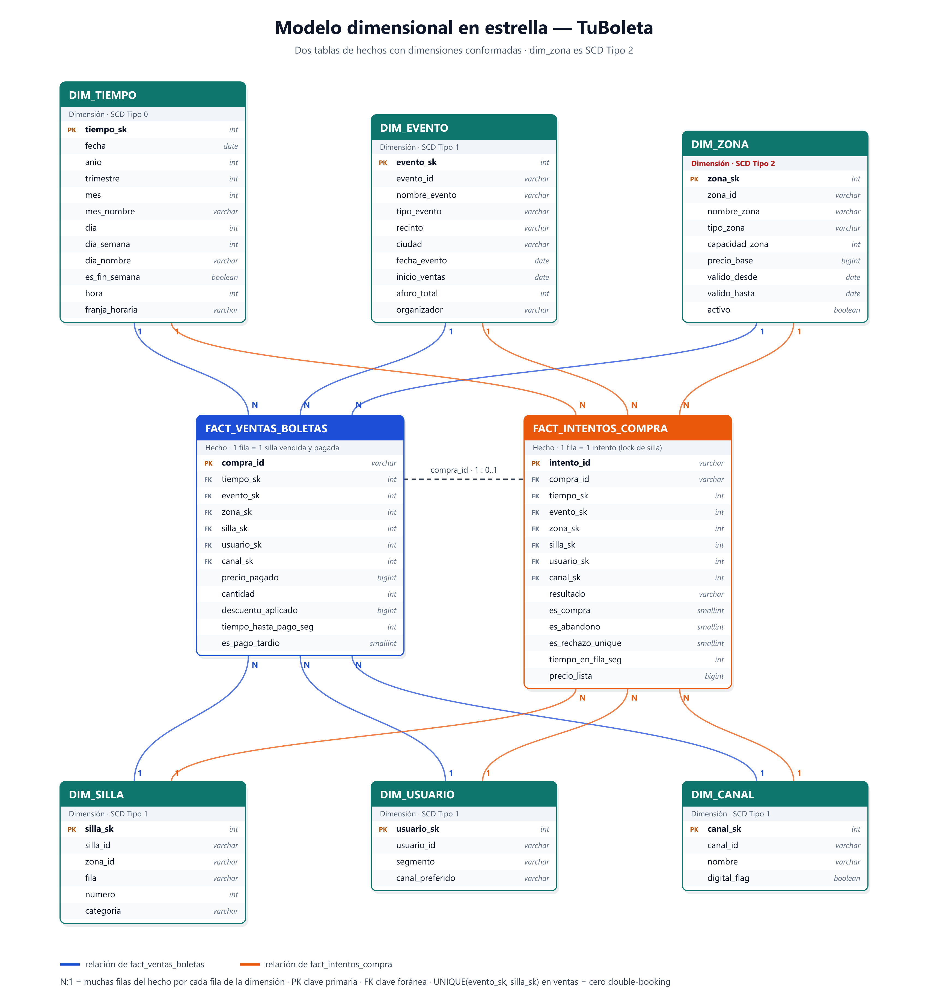

::: portada
**Instituto Tecnológico Metropolitano (ITM)**

# Mini-Lakehouse TuBoleta {.portada-titulo}

Análisis de la venta de boletería con arquitectura Bronze / Silver / Gold, Parquet y DuckDB

**Informe final**

Curso: Tópicos Avanzados en Bases de Datos — Entrega final

**Integrantes**\
Luis Manuel Contreras\
Juan Pablo Salazar

**Docente**\
Roberto Carlos Rahamut Suteu

Noviembre de 2026

Repositorio: github.com/JPS4L4/tuboleta_lakehouse
:::

# Resumen ejecutivo {.salto}

El proyecto desarrolla un mini-lakehouse para analizar la comercialización de boletería de eventos en el Estadio Atanasio Girardot. La arquitectura separa la operación transaccional de la analítica: CockroachDB conserva el snapshot OLTP y aplica la unicidad evento–silla; Parquet organiza las capas Bronze, Silver y Gold; DuckDB consulta el modelo dimensional. Redis se documenta como componente propuesto para fila y bloqueos temporales, pero no se despliega en el prototipo.

El conjunto funcional es sintético y reproducible: 208.236 ventas confirmadas, 260.294 intentos, 45.000 sillas, 150.000 usuarios, cinco eventos y seis versiones de zona. El pipeline batch transforma siete tablas operacionales, conserva trazabilidad en Bronze, corrige calidad y tipos en Silver y construye dos hechos y seis dimensiones en Gold, con SCD Tipo 2 para el historial de precios de zona.

Las consultas de negocio cubren ingresos, ocupación, canales, conversión y cambios de precio. En la corrida analítica más reciente, DuckDB sobre Gold obtuvo una mediana de 10,12 ms frente a 287,29 ms de SQLite para la agregación evento–zona–mes; es una comparación OLAP y no una medición directa de CockroachDB.

M4 evaluó cuatro técnicas: el ordenamiento redujo los bytes leídos 1,8 veces, pero no el tiempo (0,99x); el particionado Hive redujo los bytes 4,2 veces, pero empeoró el tiempo 29 % por overhead; la conversión VARCHAR→TIMESTAMP mejoró 3,35x; y el índice compuesto de CockroachDB mejoró 2,02x la lectura, con un costo de inserción cercano al 16,2 %. Estas cifras son las de la corrida final del 26-11-2026. Los resultados muestran que el plan y el volumen leído deben analizarse junto con el tiempo y el costo de escritura.

El prototipo demuestra integración batch, calidad, modelado dimensional y experimentación reproducible en un entorno local. No representa ventas reales, despliegue productivo, CDC, streaming, Redis ejecutado ni tolerancia a fallos multi-nodo.

# 1. Contexto del dominio, cargas de trabajo y requisitos {.salto}

## 1.1. Contexto y problema de negocio

El proyecto modela la comercialización de boletería para eventos en el Estadio Atanasio Girardot, Medellín. La solución atiende dos necesidades con perfiles de acceso diferentes:

1. **Operación transaccional (OLTP):** registrar compras confirmadas y resultados de intentos de compra, evitando que una misma silla se venda dos veces para un mismo evento.
2. **Análisis histórico (OLAP):** consultar ventas, ingresos, ocupación, comportamiento por canal y conversión del proceso de compra por evento, zona y período.

La arquitectura separa el plano operacional del analítico. CockroachDB representa la fuente transaccional de verdad; Redis aparece en el diseño como componente de estado efímero para fila virtual y bloqueos temporales; Parquet almacena las extracciones en Bronze, Silver y Gold; DuckDB ejecuta consultas analíticas sobre los archivos Parquet.

**Alcance real del prototipo.** El repositorio implementa el generador sintético, el laboratorio local de CockroachDB, la carga de un snapshot sintético, la extracción desde CockroachDB, las transformaciones Parquet y el análisis con DuckDB. Redis no se despliega ni ejecuta: la fila y los locks se representan mediante reglas y resultados generados sintéticamente. Por tanto, el proyecto demuestra el flujo de datos y las restricciones transaccionales en CockroachDB, pero no mide concurrencia de Redis ni el comportamiento de una plataforma de venta en producción.

## 1.2. Dominio, actores y proceso de compra

| Actor o componente | Responsabilidad |
|---|---|
| Comprador | Selecciona un evento y una silla, inicia un intento y completa o no el pago. |
| Servicio de fila virtual | En el diseño, regula la admisión de compradores en períodos de alta demanda. No está implementado como servicio. |
| Gestor de bloqueo de sillas | En el diseño, reserva temporalmente una silla mediante un lock con TTL. Se representa conceptualmente con Redis; no se ejecuta en el laboratorio. |
| Servicio transaccional | Persiste la compra confirmada y aplica la regla de unicidad evento–silla en CockroachDB. |
| Proceso de extracción | Lee las siete tablas operacionales o genera datos sintéticos y escribe los archivos Bronze. |
| Proceso analítico | Limpia, tipa, modela y consulta los datos con Python, Parquet y DuckDB. |
| Analista / responsable del evento | Consulta ventas, ingresos, ocupación, canales y resultados del embudo. |

El flujo conceptual es: el comprador ingresa a la fila virtual, es admitido, solicita el bloqueo temporal de una silla y paga dentro del tiempo permitido. La configuración define un TTL de **600 segundos**. Si vence el TTL sin pago, el intento puede terminar como **ABANDONO** y la silla liberarse. Si otro comprador ya registró la misma silla para el evento, la restricción única de CockroachDB rechaza la segunda compra; el intento se clasifica como **RECHAZO_UNIQUE**.

La regla de integridad central es que una silla no puede venderse dos veces para un evento. En OLTP se materializa mediante la restricción única sobre **(evento_id, silla_id)** en **compras_confirmadas**. En Gold se replica con unicidad sobre **(evento_sk, silla_sk)** en **fact_ventas_boletas** y se valida durante la transformación.

Se analizan dos procesos con granularidades diferentes:

- **Ventas:** una fila representa una silla vendida y pagada en un evento.
- **Embudo de compra:** una fila representa un intento asociado a una silla, con resultado COMPRA, ABANDONO o RECHAZO_UNIQUE.

Un abandono no se contabiliza como venta. Esta separación evita inflar los ingresos al mezclar hechos de distinta naturaleza.

## 1.3. Datos y volumen de referencia

Los datos son sintéticos y reproducibles mediante una semilla fija (**SEED = 42**). El generador modela cinco eventos, cuatro zonas, tres canales, 45.000 sillas y 150.000 usuarios. Los precios de VIP y Occidental cambian el 1 de julio de 2026 para permitir el análisis histórico mediante SCD Tipo 2.

En una ejecución funcional documentada, Gold contiene:

| Elemento | Volumen |
|---|---:|
| Eventos | 5 |
| Zonas de negocio | 4 |
| Versiones de zona | 6 |
| Canales de origen | 3 |
| Sillas | 45.000 |
| Usuarios | 150.000 |
| Ventas confirmadas | 208.236 |
| Intentos de compra | 260.294 |
| Registros de dimensión tiempo | 5.656 |

Estos valores describen el conjunto de prueba del repositorio. No son ventas históricas reales, capacidad productiva ni tasas observadas de conversión de TuBoleta. Las tasas de abandono, rechazo, descuento y pago tardío son parámetros del generador.

## 1.4. Cargas de trabajo

| Carga | Tipo | Escala demostrada | Patrón de acceso | Consistencia requerida |
|---|---|---|---|---|
| Confirmar compra | OLTP, escritura puntual | Una compra por silla/evento; snapshot funcional de 208.236 ventas | Inserción por clave de compra y validación de unicidad | Alta: no aceptar dos ventas para la misma silla/evento |
| Consultar compra o intento | OLTP, lectura puntual | Tablas de compras e intentos | Búsqueda por identificadores de compra, intento, evento o silla | Lectura coherente con el estado transaccional |
| Registrar resultado del intento | OLTP, escritura | 260.294 intentos en el snapshot | Inserción de un resultado por intento | Distinguir compra, abandono y rechazo |
| Extraer datos | Batch / ETL | Siete tablas operacionales | Lectura por tabla mediante SELECT; ejecución por lote | Snapshot del momento de extracción; no hay CDC |
| Limpiar y tipar | Batch / ETL | Todo el conjunto extraído | Procesamiento de archivos Parquet | Reglas deterministas de deduplicación, tipado e imputación |
| Construir el modelo analítico | Batch / OLAP | Dos hechos y seis dimensiones | Reconstrucción completa de Gold | Integridad de claves y correspondencia temporal SCD2 |
| Consultas de negocio | OLAP, lectura intensiva | 208.236 ventas y 260.294 intentos | Agregaciones por evento, zona, canal y período | Consistencia del snapshot; no es lectura transaccional en tiempo real |

Las consultas de negocio que justifican el modelo son: ventas e ingresos por evento/zona/mes; conversión de intentos; ventas por canal; ocupación por evento y zona; y variación de ingresos según la versión del precio de una zona.

## 1.5. Requisitos funcionales

1. Registrar compras confirmadas e intentos con identificadores de negocio.
2. Impedir la doble venta de una silla dentro de un mismo evento.
3. Diferenciar compras pagadas, abandonos y rechazos por unicidad.
4. Conservar fecha y hora de compra e intento para el análisis temporal.
5. Identificar evento, silla, usuario, zona y canal asociados a cada registro.
6. Mantener el histórico de cambios de precio de las zonas mediante versiones con vigencia.
7. Extraer las tablas operacionales a Bronze sin ocultar valores nulos que deben tratarse en Silver.
8. Producir un modelo Gold que permita responder consultas de ventas y del embudo de compra.

## 1.6. Requisitos no funcionales

El repositorio no define acuerdos de nivel de servicio (SLA/SLO) de producción ni mide la disponibilidad de una plataforma distribuida. Se separan los atributos derivados del diseño de las metas que todavía tendrían que acordarse con el negocio.

| Atributo | Requisito de diseño | Evidencia o límite actual |
|---|---|---|
| Integridad transaccional | No permitir más de una compra por evento–silla | Restricción UNIQUE en CockroachDB y validación equivalente en Gold |
| Consistencia | Priorizar la corrección de la compra sobre la disponibilidad de una réplica aislada | CockroachDB es fuente de verdad; laboratorio de un nodo |
| Disponibilidad | La fila virtual puede degradarse sin comprometer la regla final de venta | Redis no está desplegado; no hay medición |
| Rendimiento OLTP | Operaciones puntuales y acceso eficiente por claves | Existe experimento de índice; no hay SLO productivo |
| Rendimiento OLAP | Consultas eficientes sobre columnas y agregaciones | DuckDB consulta Parquet Gold; hay benchmarks locales |
| Escalabilidad | Separar carga transaccional de escaneos analíticos | Separación arquitectónica; entorno local y dataset sintético |
| Calidad de datos | Deduplicar, normalizar IDs, tipar fechas, tratar nulos y descartar filas sin clave | Silver y reporte de calidad |
| Reproducibilidad | Regenerar datos y repetir el pipeline | Semilla fija 42 y comando python main.py |
| Retención y trazabilidad | Identificar archivos por tabla, extracción y fuente | Bronze agrega _extraido_en y _fuente; no hay política formal de retención |
| Seguridad | No usar configuración insegura en producción | --insecure y root se limitan al laboratorio; falta endurecimiento productivo |

Quedan pendientes de definición con el negocio: latencia máxima de compra, disponibilidad mensual, RPO/RTO, retención histórica, volumen máximo esperado, concurrencia pico, presupuesto y objetivo de frescura del lakehouse. No se asignan cifras sin requisitos o pruebas que las respalden.

## 1.7. Decisión CAP por subsistema

CAP se utiliza como criterio de diseño para servicios distribuidos bajo una partición de red. La clasificación describe la intención arquitectónica, no una prueba de tolerancia a fallos ejecutada en el laboratorio.

| Subsistema | Prioridad de diseño | Justificación y estado |
|---|---|---|
| Redis (fila y locks efímeros) | AP, según el diseño documentado | Se busca mantener disponible la admisión y el estado temporal cuando sea posible. El estado no es autoridad final de venta. Redis no está desplegado ni probado; AP es una decisión conceptual. |
| CockroachDB (compras confirmadas) | CP, según el diseño documentado | Se priorizan consistencia y unicidad; una partición sin quórum puede reducir disponibilidad antes que aceptar ventas conflictivas. El laboratorio de un nodo no valida particiones de clúster. |
| Parquet / Bronze-Silver-Gold | No se asigna categoría CAP en este prototipo | Son snapshots derivados por lotes; no coordinan escrituras transaccionales distribuidas. |
| DuckDB | No se usa como coordinador transaccional distribuido | Ejecuta lecturas analíticas locales sobre Parquet y no reemplaza la fuente de verdad. |

La confirmación final depende de CockroachDB y de la restricción única evento–silla. Así, un estado temporal de fila o bloqueo no se convierte en autoridad de compra. La clasificación CP expresa la decisión de diseño y las garantías transaccionales buscadas, no una prueba CAP del despliegue local.

# 2. Arquitectura de persistencia políglota e integración

## 2.1. Vista general

La arquitectura asigna cada tecnología a un tipo de dato y patrón de acceso. CockroachDB atiende las operaciones transaccionales; Redis se contempla para estado temporal; Parquet conserva los datos históricos en capas; DuckDB ejecuta las consultas analíticas. Python y pandas coordinan generación, extracción y transformaciones.

~~~text
              PROCESO DE VENTA (diseño operacional)
 Comprador
    |
    v
 Fila virtual / admisión
    |
    v
 Redis (previsto, no ejecutado)
 - estado de fila
 - lock de silla, TTL = 600 s
 - contadores efímeros
    |
    v
 Servicio de compra
    |
    v
 CockroachDB (implementado en laboratorio)
 - compras_confirmadas
 - intentos_compra
 - UNIQUE(evento_id, silla_id)
    |
    | extracción batch (SELECT *)
    v
 BRONZE / Parquet
 - snapshot por tabla
 - _extraido_en / _fuente
    |
    | transform_silver.py
    v
 SILVER / Parquet
 - normalización y deduplicación
 - conversión de tipos y tratamiento de nulos
    |
    | transform_gold.py
    v
 GOLD / Parquet
 - 2 tablas de hechos
 - 6 dimensiones conformadas
 - SCD Tipo 2 en dim_zona
    |
    | DuckDB / read_parquet
    v
 Consultas de negocio y benchmark
 - scripts/analyze.py
 - scripts/consultar.py
~~~

Redis pertenece al flujo conceptual de admisión y bloqueo, pero no es dependencia del pipeline ejecutable. El pipeline puede correr en modo sintético sin CockroachDB; alternativamente, puede extraer el snapshot cargado en CockroachDB con USE_SYNTHETIC=false.

## 2.2. Persistencia políglota: responsabilidades

| Tecnología | Modelo y datos | Patrón de acceso | Justificación | Estado en el proyecto |
|---|---|---|---|---|
| CockroachDB | Relacional SQL; catálogos y transacciones de compra | Inserciones, lecturas puntuales y restricciones | Fuente transaccional y regla evento–silla expresada en la base | Nodo local Docker, snapshot sintético cargable y extracción verificada |
| Redis | Clave–valor efímero; fila, locks y contadores | Lecturas/escrituras rápidas con expiración | Estado temporal de admisión y reserva, separado del histórico de ventas | Diseñado/documentado; no desplegado |
| Parquet | Archivos columnares tipados | Lectura analítica por columnas, row groups y particiones | Almacenamiento histórico desacoplado del motor transaccional | Implementado en Bronze, Silver y Gold |
| DuckDB | Motor SQL analítico embebido | Escaneos columnares, filtros, joins y agregaciones | Ejecutar OLAP sobre archivos sin operar otro servidor | Implementado y usado en consultas/benchmarks |
| Python / pandas | Procesamiento tabular | ETL por lotes | Generación, extracción y transformaciones | Implementado |

Un motor relacional transaccional es apropiado para confirmar una compra porque la operación necesita restricciones e integridad sobre registros individuales. Las consultas analíticas, en cambio, recorren muchas ventas para agrupar por tiempo, evento, zona o canal. La separación OLTP/OLAP evita que los escaneos históricos compitan directamente con la ruta transaccional. DuckDB consulta Parquet sin convertir el almacén de archivos en una base transaccional.

## 2.3. Esquema operacional de CockroachDB

El DDL se encuentra en **oltp/init/01_schema.sql**. El cargador **scripts/oltp/load_cockroach.py** crea la base tuboleta, ejecuta el esquema y carga las siete tablas operacionales.

| Tabla | Clave primaria | Función |
|---|---|---|
| canales | canal_id | Catálogo de canales |
| zonas | (zona_id, valido_desde) | Tarifario e historial de versiones de zona |
| eventos | evento_id | Catálogo de eventos |
| sillas | silla_id | Inventario lógico de sillas y zona asociada |
| usuarios | usuario_id | Atributos de usuario |
| compras_confirmadas | compra_id | Compra pagada |
| intentos_compra | intento_id | Resultado persistido de cada intento |

La tabla **compras_confirmadas** contiene una clave primaria sobre compra_id y una restricción **UNIQUE(evento_id, silla_id)**, denominada **uq_compra_evento_silla**. También conserva fecha_compra como TIMESTAMP y permite canal_id nulo para que la calidad del dato se trate en Silver.

La unicidad evento–silla es la protección transaccional central contra el *double-booking*. Una segunda inserción con la misma combinación no puede convertirse en otra compra confirmada. El esquema no declara claves foráneas entre todas las tablas de catálogo y transacción; las relaciones por identificadores se utilizan durante la extracción y construcción del modelo analítico, por lo que no se atribuyen al DDL restricciones FK que no aparecen allí.

El esquema incluye además tablas experimentales para el benchmark OLTP. No forman parte de las siete tablas operacionales que extrae **scripts/extract.py**; el benchmark de índice se documenta por separado.

Ejemplo ilustrativo de consulta de una silla vendida:

~~~sql
SELECT compra_id, fecha_compra
FROM compras_confirmadas
WHERE evento_id = 'E-002'
  AND silla_id = 'S-00001';
~~~

La consulta permite verificar el estado persistido, pero la garantía definitiva es la restricción UNIQUE: una consulta previa por sí sola no evita carreras entre solicitudes concurrentes.

## 2.4. Redis y estado efímero

En el diseño, Redis cumple una función distinta de CockroachDB: mantiene el estado temporal de la fila virtual, los locks de silla con TTL de **600 segundos** y contadores operativos. Si vence el lock sin pago, el intento puede terminar como ABANDONO. Redis no se considera la fuente definitiva de una compra confirmada.

La configuración define **TTL_LOCK_SEG = 600** y un umbral de pago tardío en el 80 % del TTL. El generador produce resultados de intentos y la marca de pago tardío a partir de datos sintéticos; no consulta una instancia Redis.

**Límite de implementación:** no existe servicio Redis en docker-compose.yml, no hay cliente Redis en las dependencias del pipeline y no se ejecutan operaciones SET NX EX. Por ello, el proyecto no demuestra adquisición concurrente de locks, liberación por expiración, recuperación ni rendimiento de Redis. Es una pieza de arquitectura propuesta y simulada por el generador.

## 2.5. Almacenamiento Lakehouse e integración

| Capa | Formato y contenido | Transformación | Propósito |
|---|---|---|---|
| Bronze | Parquet crudo por tabla y extracción | Agrega _extraido_en y _fuente; conserva la estructura recibida | Trazabilidad y conservación del dato de origen |
| Silver | Parquet limpio y tipado | Deduplicación, normalización de IDs, conversión de fechas, imputación de canal_id nulo y descarte de filas sin clave | Calidad técnica y tipos consistentes |
| Gold | Parquet dimensional | Dimensiones, claves sustitutas, dos hechos y resolución temporal SCD2 | Consultas analíticas y métricas de negocio |
| DuckDB | Vistas/consultas read_parquet sobre Gold | Filtros, joins y agregaciones SQL | Acceso analítico sin cargar el snapshot en un servidor |

La integración implementada es **batch**:

1. El cargador opcional prepara un snapshot sintético en CockroachDB.
2. **extract.py** lee las siete tablas con SELECT * o llama al generador sintético.
3. Bronze conserva un archivo Parquet por tabla y extracción.
4. Silver procesa la extracción más reciente.
5. Gold reconstruye el modelo dimensional.
6. DuckDB consulta Gold para producir resultados y benchmarks.

El modo predeterminado usa USE_SYNTHETIC=true y no requiere CockroachDB. Con USE_SYNTHETIC=false, la extracción lee el snapshot cargado en CockroachDB. El cargador OLTP conserva canal_id nulo; la imputación a DESCONOCIDO ocurre en Silver, no durante la carga de la base.

No existe integración streaming ni CDC implementada, ni un programador de cargas recurrentes. La frescura del lakehouse depende de cuándo se ejecuta manualmente el pipeline; los datos analíticos no están sincronizados en tiempo real. La latencia de actualización equivale a la duración de una corrida (6,92 s en la corrida final del 26-11-2026), sin marca de agua persistente. CDC o una estrategia incremental con marca de agua quedan como evolución futura, no como parte del prototipo.

## 2.6. Decisiones y límites de la arquitectura

- **CockroachDB** es la fuente de verdad para las compras confirmadas y aplica la unicidad evento–silla.
- **Redis** se propone para estado efímero; su disponibilidad no reemplaza la garantía transaccional de CockroachDB.
- **Bronze, Silver y Gold** son snapshots derivados por lotes y pueden estar temporalmente desactualizados respecto de OLTP.
- **DuckDB** consulta el último Gold generado y no coordina escrituras de compra.
- El nodo CockroachDB de docker-compose.yml utiliza **start-single-node --insecure**. Esta configuración reproduce el laboratorio, pero no valida particiones, quórum ni tolerancia a fallos de un clúster distribuido.
- La arquitectura separa patrones transaccionales y analíticos; no implica que CockroachDB no pueda ejecutar consultas analíticas, sino que DuckDB/Parquet se seleccionó para demostrar el patrón OLAP del proyecto.

## 2.7. Justificación y alternativas tecnológicas

**CockroachDB** se eligió para la fuente operacional por su modelo relacional, sus transacciones y sus restricciones de integridad; la restricción única evento–silla protege la regla de no vender dos veces el mismo asiento. PostgreSQL sería una alternativa relacional válida; no se hizo una prueba comparativa directa entre ambos, por lo que no se afirma superioridad de rendimiento.

**DuckDB** se eligió para OLAP porque consulta Parquet directamente y evita administrar un servidor analítico adicional en el entorno académico local. Spark sería una alternativa ante necesidades de procesamiento distribuido que no forman parte del alcance medido.

**Parquet** se prefirió sobre CSV como almacenamiento analítico porque es columnar, conserva tipos y habilita lectura selectiva y *pruning* por grupos y particiones. CSV sigue siendo útil para intercambio, pero no se seleccionó como formato principal del lakehouse.

No se debe describir Redis como una base desplegada ni Parquet como un motor de base de datos: Parquet es el formato de almacenamiento y DuckDB el motor analítico.

# 3. Diseño dimensional {.salto}



El modelo fuente está en `docs/modelo_dimensional.dbml`; la imagen se generó a partir de ese DBML.

## Las cinco preguntas

**1. Proceso de negocio.** El comportamiento de las ventas de boletas por evento, zona, canal y período, junto con el embudo de intentos que lo precede.

**2. Granularidad.**

| Tabla de hechos | Una fila es... |
|---|---|
| `fact_ventas_boletas` | una silla vendida y pagada en un evento |
| `fact_intentos_compra` | un intento de compra (lock de una silla) que termina en `COMPRA`, `ABANDONO` o `RECHAZO_UNIQUE` |

Los abandonos no son ventas: si se mezclaran, cada `SUM(precio_pagado)` tendría que acordarse de filtrar. El pipeline verifica con `assert` que no hay *double-booking*, que cada venta enlaza con exactamente un intento `COMPRA` y que cada hecho resolvió exactamente una versión de zona.

**3. Dimensiones (conformadas).** Ambos hechos comparten las seis dimensiones.

| Dimensión | Tipo SCD | Nota |
|---|---|---|
| `dim_tiempo` | Tipo 0 | Granularidad de hora; franjas madrugada, mañana, tarde y noche |
| `dim_evento` | Tipo 1 | Nombre, fecha, inicio de ventas, aforo |
| `dim_zona` | **Tipo 2** | Única cuyos cambios alteran el significado de las métricas (el precio) |
| `dim_silla` | Tipo 1 | Zona, fila, número |
| `dim_usuario` | Tipo 1 | Segmento y canal preferido |
| `dim_canal` | Tipo 1 | Incluye el miembro `DESCONOCIDO` para canales nulos |

**4. Métricas.**

| Métrica | Hecho | Tipo |
|---|---|---|
| `precio_pagado`, `descuento_aplicado`, `cantidad` | ventas | Aditiva |
| `tiempo_hasta_pago_seg` | ventas | No aditiva (solo `AVG` o percentiles) |
| `es_pago_tardio` | ventas | Flag: pago en el último 20 % del TTL; sigue siendo venta válida |
| `es_compra`, `es_abandono`, `es_rechazo_unique` | intentos | Flags 0/1 para conteos y tasas |
| `tiempo_en_fila_seg` | intentos | No aditiva |
| `precio_lista` | intentos | Aditiva; con abandono estima el ingreso potencial perdido |

Con esta granularidad no hay métricas semi-aditivas. Aparecerían con una instantánea periódica de inventario (por ejemplo `sillas_disponibles` por zona y día): se puede sumar entre zonas, pero no a lo largo del tiempo, donde se usa el último valor o el promedio del período.

**5. Cambios lentos (SCD Tipo 2 en `dim_zona`).** Cuando cambia el precio de una zona se cierra la versión anterior (`valido_hasta`, `activo = false`) y se inserta una nueva con otro `zona_sk`. Cada hecho guarda el `zona_sk` vigente en su fecha. El 2026-07-01 suben VIP y Occidental:

| zona_sk | zona_id | nombre_zona | precio_base | valido_desde | valido_hasta | activo |
|---|---|---|---:|---|---|---|
| 1 | Z-VIP | VIP | 250.000 | 2026-01-01 | 2026-06-30 | false |
| 2 | Z-VIP | VIP | 280.000 | 2026-07-01 | 9999-12-31 | true |
| 3 | Z-OCC | Occidental | 150.000 | 2026-01-01 | 2026-06-30 | false |
| 4 | Z-OCC | Occidental | 165.000 | 2026-07-01 | 9999-12-31 | true |

Hay eventos cuya ventana de ventas cruza el 1 de julio, así que un mismo evento vende boletas a dos precios. Los análisis por zona agrupan por `zona_id`, nunca por versión, y no filtran `activo = true`: de lo contrario se perderían las ventas anteriores al cambio.

**El estado de Redis no es un hecho.** La fila virtual, los locks vivos y los contadores son efímeros y no describen un evento terminado. Sí es hecho el resultado de cada intento que el sistema operacional persiste.

# 4. Pipeline ETL y reporte de calidad {.salto}

**Extracción.** Genera datos sintéticos (o extrae de CockroachDB con `USE_SYNTHETIC=false`) hacia Bronze, un archivo Parquet por tabla y por extracción.

**Suciedad intencional en Bronze.** Para que Silver tenga trabajo real, el generador inyecta los problemas típicos de un volcado operacional: filas duplicadas (~1 %), IDs con espacios sobrantes (~1,5 %), fechas como texto, `canal_id` nulo (~1,5 %) y 40 filas sin clave de negocio.

**Silver** deduplica por clave de negocio, aplica `strip`, convierte fechas, reemplaza el canal nulo por `DESCONOCIDO` y descarta las filas sin clave. **Gold** construye las dimensiones, resuelve claves sustitutas y la versión de zona, y ejecuta las verificaciones de integridad.

**Reporte de calidad de la última ejecución** (`docs/reporte_calidad_silver.txt`, 26-11-2026 16:40). Esta evidencia corresponde a la extracción desde CockroachDB (`USE_SYNTHETIC=false`), no a la ruta sintética directa:

| Tabla | Filas Bronze | Filas Silver | % retenido | Duplicados | Sin clave | Nulos resueltos |
|---|---:|---:|---:|---:|---:|---:|
| canales | 3 | 3 | 100,00 | 0 | 0 | 0 |
| zonas | 6 | 6 | 100,00 | 0 | 0 | 0 |
| eventos | 5 | 5 | 100,00 | 0 | 0 | 0 |
| sillas | 45.000 | 45.000 | 100,00 | 0 | 0 | 0 |
| usuarios | 150.000 | 150.000 | 100,00 | 0 | 0 | 0 |
| compras_confirmadas | 208.236 | 208.236 | 100,00 | 0 | 0 | 3.101 |
| intentos_compra | 260.294 | 260.294 | 100,00 | 0 | 0 | 3.906 |

Los valores nulos de `canal_id` se conservaron desde CockroachDB hasta Bronze y fueron imputados como `DESCONOCIDO` en Silver. No se perdieron ventas ni ingresos en esta ejecución: `precio_pagado` suma 22.126.123.800 COP tanto en Bronze como en Silver.

**Prueba de limpieza con anomalías sintéticas.** En la ruta directa del generador (`USE_SYNTHETIC=true`), Bronze contiene 150.750 usuarios, 210.358 compras y 262.936 intentos. Silver retiene 150.000, 208.236 y 260.294, respectivamente; elimina 750, 2.082 y 2.602 duplicados, descarta 40 compras y 40 intentos sin clave, e imputa 3.101 y 3.906 nulos de canal. En compras, el total pasa de 22.352.656.600 COP a 22.126.123.800 COP. Estos conteos pertenecen a una ejecución distinta y no se mezclan con la tabla anterior. El detalle de ambas rutas está en `docs/taller4/ejecuciones_pipeline.md`.

**Separación de responsabilidades.** El cargador de CockroachDB no ejecuta la limpieza de Silver: aplica las restricciones estructurales de OLTP y conserva `canal_id` nulo. Silver realiza la imputación a `DESCONOCIDO`, que es un miembro técnico válido de `dim_canal`, no una categoría inferida.

**Volúmenes de Gold.**

| Tabla | Filas |
|---|---:|
| `fact_ventas_boletas` | 208.236 |
| `fact_intentos_compra` | 260.294 (+25 % sobre las ventas) |
| Sillas / usuarios | 45.000 / 150.000 |
| Eventos / versiones de zona | 5 / 6 |
| `dim_tiempo` (hora) | 5.656 |

# 5. Consultas analíticas {.salto}

Se ejecutan nueve consultas de negocio sobre Gold con DuckDB (`scripts/analyze.py`); las salidas completas están en `docs/resultados_consultas.md`. Los ingresos suman **22.126 millones de COP con 208.236 boletas**. Resultados clave:

**Ingresos por canal.** La app vende el 44 %, la web el 39 %, la taquilla el 15 % y el 1,5 % no tiene canal registrado.

| Canal | Boletas | % | Ingresos (COP) | Ticket promedio |
|---|---:|---:|---:|---:|
| app | 92.066 | 44,21 | 9.779.126.100 | 106.219 |
| web | 82.058 | 39,41 | 8.716.875.500 | 106.228 |
| taquilla | 31.011 | 14,89 | 3.301.901.100 | 106.475 |
| DESCONOCIDO | 3.101 | 1,49 | 328.221.100 | 105.844 |

**Ocupación.** Entre 85,8 % y 100 % por zona; el Clásico Paisa agotó VIP y Occidental.

**Embudo de conversión por evento.** De cada 100 intentos, cerca de 80 terminan en compra, 14 en abandono y 6 en rechazo `UNIQUE`; alrededor del 8 % de las ventas se paga en el último tramo del TTL (estas tasas salen de los parámetros del generador).

| Evento | Intentos | Compras | Abandonos | Rechazos | Conversión % |
|---|---:|---:|---:|---:|---:|
| Clásico Paisa Nacional vs Medellín | 54.577 | 43.625 | 7.468 | 3.484 | 79,93 |
| Festival Sonidos del Valle | 53.295 | 42.455 | 7.373 | 3.467 | 79,66 |
| Final del Fútbol Colombiano | 53.161 | 42.667 | 7.174 | 3.320 | 80,26 |
| Gira Urbana Medellín | 49.947 | 40.069 | 6.752 | 3.126 | 80,22 |
| Concierto Noche Latina | 49.314 | 39.420 | 6.633 | 3.261 | 79,94 |

**SCD Tipo 2: VIP por versión de precio.** Sin SCD2 esta diferencia de precio se perdería.

| zona_sk | Precio base | Vigencia | Boletas | Ingresos (COP) | Ticket promedio |
|---|---:|---|---:|---:|---:|
| 1 | 250.000 | 2026-01-01 a 2026-06-30 | 5.834 | 1.411.662.500 | 241.972 |
| 2 | 280.000 | desde 2026-07-01 | 8.041 | 2.186.856.000 | 271.963 |

**Horarios.** Tarde (35,85 %) y noche (34,66 %) concentran cerca del 70 % de las ventas; el primer día de venta de cada evento concentra alrededor del 10 %.

**Abandono.** Los abandonos asocian 3.868 millones de COP de precio de lista, una cota superior del ingreso potencial perdido (parte de esas sillas se vendió después a otro usuario). Por zona: Occidental 1.494, Norte 994, General 757 y VIP 623 millones de COP.

Además de las nueve consultas ejecutadas por `scripts/analyze.py`, el documento `docs/entrega_final/consultas_sql_resultados.md` reúne cinco consultas SQL completas, con su propósito y resultados de referencia (ingresos por canal, ocupación, embudo de conversión, evolución de precios SCD2 y análisis por evento y período). Los resultados corresponden a la ejecución de referencia indicada en ese archivo; al reproducir la entrega en otro equipo deben regenerarse Gold y las consultas para confirmar que coinciden.

## 5.1. Consultas SQL de negocio sobre Gold

Estas son las cinco consultas completas de `docs/entrega_final/consultas_sql_resultados.md`, ejecutables con DuckDB sobre los Parquet de Gold. Sus resultados de referencia son los de las tablas anteriores y los de `docs/resultados_consultas.md` (corrida final del 26-11-2026).

### Consulta 1. Ingresos y boletas por evento y mes

**Pregunta:** ¿Cómo se distribuyen las ventas de cada evento durante su ventana de venta?

```sql
SELECT
    e.nombre_evento,
    t.anio,
    t.mes,
    t.mes_nombre,
    COUNT(*) AS boletas,
    CAST(SUM(f.precio_pagado) AS BIGINT) AS ingresos
FROM fact_ventas_boletas f
JOIN dim_tiempo t ON t.tiempo_sk = f.tiempo_sk
JOIN dim_evento e ON e.evento_sk = f.evento_sk
GROUP BY
    e.fecha_evento, e.nombre_evento,
    t.anio, t.mes, t.mes_nombre
ORDER BY e.fecha_evento, t.anio, t.mes;
```

**Qué demuestra:** permite seguir el volumen y los ingresos en el tiempo sin consultar tablas operacionales normalizadas.

### Consulta 2. Ocupación e ingresos por evento y zona

**Pregunta:** ¿Qué porcentaje de la capacidad de cada zona se vendió y cuánto dinero generó?

```sql
SELECT
    e.nombre_evento,
    z.nombre_zona,
    MAX(z.capacidad_zona) AS capacidad_zona,
    COUNT(*) AS vendidas,
    ROUND(100.0 * COUNT(*) / MAX(z.capacidad_zona), 2) AS ocupacion_pct,
    CAST(SUM(f.precio_pagado) AS BIGINT) AS ingresos
FROM fact_ventas_boletas f
JOIN dim_zona z ON z.zona_sk = f.zona_sk
JOIN dim_evento e ON e.evento_sk = f.evento_sk
GROUP BY
    e.fecha_evento, e.nombre_evento,
    z.zona_id, z.nombre_zona
ORDER BY e.fecha_evento, ingresos DESC;
```

**Qué demuestra:** combina una métrica operativa (ocupación) con ingresos y capacidad de la dimensión.

### Consulta 3. Volumen, ingresos y ticket promedio por canal

**Pregunta:** ¿Qué canal vende más y cuál es el ticket promedio?

```sql
SELECT
    c.nombre AS canal,
    COUNT(*) AS boletas,
    ROUND(100.0 * COUNT(*) / SUM(COUNT(*)) OVER (), 2) AS boletas_pct,
    CAST(SUM(f.precio_pagado) AS BIGINT) AS ingresos,
    CAST(ROUND(AVG(f.precio_pagado), 0) AS BIGINT) AS ticket_promedio,
    CAST(ROUND(AVG(f.descuento_aplicado), 0) AS BIGINT) AS descuento_promedio
FROM fact_ventas_boletas f
JOIN dim_canal c ON c.canal_sk = f.canal_sk
GROUP BY c.nombre
ORDER BY ingresos DESC;
```

**Qué demuestra:** compara canales y mantiene visibles los registros cuyo canal no pudo identificarse en origen.

### Consulta 4. Embudo de conversión por evento

**Pregunta:** ¿Cuántos intentos terminan en compra, abandono o rechazo por unicidad?

```sql
WITH intentos AS (
    SELECT
        d.nombre_evento AS evento,
        COUNT(*) AS intentos,
        CAST(SUM(i.es_compra) AS BIGINT) AS compras,
        CAST(SUM(i.es_abandono) AS BIGINT) AS abandonos,
        CAST(SUM(i.es_rechazo_unique) AS BIGINT) AS rechazos_unique
    FROM fact_intentos_compra i
    JOIN dim_evento d ON d.evento_sk = i.evento_sk
    GROUP BY d.nombre_evento
),
ventas AS (
    SELECT
        d.nombre_evento AS evento,
        CAST(SUM(f.es_pago_tardio) AS BIGINT) AS pagos_tardios
    FROM fact_ventas_boletas f
    JOIN dim_evento d ON d.evento_sk = f.evento_sk
    GROUP BY d.nombre_evento
)
SELECT
    i.evento,
    i.intentos,
    i.compras,
    i.abandonos,
    i.rechazos_unique,
    ROUND(100.0 * i.compras / i.intentos, 2) AS conversion_pct,
    ROUND(100.0 * i.abandonos / i.intentos, 2) AS abandono_pct,
    ROUND(100.0 * i.rechazos_unique / i.intentos, 2) AS rechazo_unique_pct,
    ROUND(100.0 * v.pagos_tardios / i.compras, 2) AS pago_tardio_pct
FROM intentos i
JOIN ventas v USING (evento)
ORDER BY i.intentos DESC;
```

**Qué demuestra:** separa intentos de ventas confirmadas y permite observar el efecto de abandono y de la restricción de unicidad.

### Consulta 5. SCD Tipo 2: ingresos VIP por versión de precio

**Pregunta:** ¿Cómo cambian las ventas y los ingresos entre las dos versiones del precio VIP?

```sql
SELECT
    z.zona_sk,
    z.nombre_zona,
    z.precio_base,
    z.valido_desde,
    z.valido_hasta,
    COUNT(*) AS boletas,
    CAST(SUM(f.precio_pagado) AS BIGINT) AS ingresos,
    CAST(ROUND(AVG(f.precio_pagado), 0) AS BIGINT) AS ticket_promedio,
    CAST(ROUND(AVG(f.descuento_aplicado), 0) AS BIGINT) AS descuento_promedio
FROM fact_ventas_boletas f
JOIN dim_zona z ON z.zona_sk = f.zona_sk
WHERE z.zona_id = 'Z-VIP'
GROUP BY
    z.zona_sk, z.nombre_zona, z.precio_base,
    z.valido_desde, z.valido_hasta
ORDER BY z.valido_desde;
```

**Qué demuestra:** conserva el historial de precios y asigna cada venta a la versión vigente en su fecha, en lugar de sobrescribir el valor histórico.

## 5.2. Dashboard (no implementado)

No se implementó un dashboard interactivo con Streamlit, Metabase u otra herramienta. Los resultados se visualizan mediante consultas SQL, salidas de consola y documentación; por eso el apartado de dashboard de la plantilla se declara **no aplicable** al alcance implementado, y no se adjuntan capturas ni se atribuyen KPIs a una interfaz inexistente. Como trabajo futuro se propone un dashboard con ingresos, boletas, ocupación, ticket promedio y conversión por evento, zona, canal y período.

# 6. Optimización de rendimiento (M4) {.salto}

La fase M4 separa el diagnóstico y la optimización analítica en DuckDB/Parquet de la optimización transaccional en CockroachDB. El Gold original del M3 se conserva; las intervenciones analíticas se ejecutan sobre artefactos independientes. Se utiliza warm-up y mediana según cada experimento, y se comprueba que los resultados lógicos antes/después sean iguales.

**Origen de las cifras.** Los tiempos de esta sección provienen de la corrida final del 26-11-2026 en esta máquina (Python 3.14.6, DuckDB 2.0.0, CockroachDB v25.4.0 de un solo nodo en Docker, Windows 11, AMD64), con el pipeline extraído desde CockroachDB (`USE_SYNTHETIC=false`). Las medianas de corridas de desarrollo anteriores fueron distintas (por ejemplo, 2,08x en la lectura con índice y 3,98x en tipos); aquí solo se reportan las de esta corrida.

### Metodología de medición y protocolos

Los protocolos no son idénticos entre experimentos y se mantienen separados; sus resultados no se combinan.

| Experimento | Calentamiento | Repeticiones reportadas | Métrica |
|---|---|---:|---|
| Ordenamiento / Hive / control DuckDB | 3 warm-ups | 5 en el laboratorio principal | Mediana |
| Corrección VARCHAR → TIMESTAMP | Calentamiento previo (no incluido en el CSV) | 9 | Mediana |
| Lectura CockroachDB con/sin índice | Calentamiento previo (no incluido en el CSV) | 7 lecturas | Mediana |
| Inserción CockroachDB | No se reporta | 3 lotes de 20.000 filas | Mediana |

Los controles complementarios (mediana de 15 corridas con 3 warm-ups) son otro protocolo y se documentan aparte en `docs/taller4/analisis_complementario.md`. Los planes y perfiles están en `docs/taller4/planes/`. Comandos de medición, desde la raíz del repositorio:

~~~text
python -m scripts.taller4_optimizacion
python -m scripts.taller4_tipos
docker compose up -d
python -m scripts.oltp.load_cockroach
python -m scripts.oltp.benchmark_cockroach
~~~

No todos los comandos generan el mismo número de repeticiones. Los archivos esperados y el protocolo se detallan en la guía de [Estadística M4 reproducible](entrega_final/estadistica_m4_reproducible.md).

### Diagnóstico de consultas

Se analizaron tres consultas: Q1, ingresos por evento en septiembre; Q2, ingresos por zona en septiembre; Q3, embudo de conversión por evento. Q1 leía 208.236 filas para devolver dos grupos, con un único row group y 261,1 kB leídos: full scan sin data skipping. Q2 leía 246,3 kB de un archivo único para retener el 16,3 % de filas: full scan con filtro empujado, pero sin pruning por archivo. Q3 agregaba los 260.294 intentos sin filtro selectivo, por lo que leer toda la fact era necesario; se utilizó como control y no se diagnosticó un problema de acceso.

### Intervenciones analíticas y OLTP

| Técnica | Antes | Después | Resultado |
|---|---:|---:|---|
| Ordenamiento por `tiempo_sk` / Q1 | 4,97 ms | 5,02 ms | 0,99x (sin ganancia de tiempo); 1/1 → 3/11 row groups; bytes 261,1 → 142,4 kB |
| Particionado Hive `year/month` / Q2 | 2,44 ms | 3,14 ms | 0,78x; 1 de 9 archivos; bytes 246,3 → 58,8 kB |
| Corrección VARCHAR + CAST → TIMESTAMP | 14,338 ms | 4,285 ms | 3,35x; mismo resultado: 34.039 ventas y COP 3.689.715.500 |
| Índice compuesto CockroachDB `(tiempo_sk, evento_sk)` | 426,217 ms | 210,591 ms | 2,02x en lectura; 1.000.000 → 164.066 filas decodificadas |
| Costo de índice en INSERT (20.000 filas) | 308,35 ms | 358,24 ms | 16,2 % más lento con índice (1,16x) |

**Interpretación.** El ordenamiento sí habilitó data skipping (3 de 11 row groups y 1,8 veces menos bytes), pero el tiempo no mejoró (0,99x): el overhead fijo y la caché explican que la reducción de lectura no llegue al tiempo, y la diferencia de medianas (0,05 ms) es menor que la desviación estándar. Hive redujo 4,2 veces los bytes leídos, pero el glob, la enumeración de carpetas y la pérdida de estadísticas hicieron que el tiempo empeorara aproximadamente 29 % con este volumen pequeño. La lectura directa del archivo mensual midió 1,26 ms, frente a 2,76 ms del glob Hive en el control complementario. La conversión a TIMESTAMP evitó un CAST por fila y presentó la mejora temporal más clara (3,35x). El índice CockroachDB redujo a la mitad el costo de lectura selectiva (2,02x), a cambio de un 16,2 % más de tiempo en escrituras.

El plan CockroachDB sin índice registró full scan de un millón de filas, 73 MiB y ocho llamadas gRPC; con índice, 164.066 filas, 9,7 MiB y una llamada. Los tiempos de EXPLAIN ANALYZE (732 ms y 241 ms) son capturas instrumentadas individuales, distintas de las medianas de siete corridas (426,217 y 210,591 ms).

Los experimentos se ejecutaron sobre datos sintéticos y en un CockroachDB de un solo nodo local. El benchmark de índice no representa ventas reales ni mide un clúster distribuido. Los archivos de evidencia, SQL completos, planes antes/después, entorno y comandos están en [`docs/taller4/`](taller4/) y en el documento [M4 — Diagnóstico y optimización](entrega_final/M4_optimizacion_rendimiento.md).

**Estadística de dispersión.** Los scripts M4 exportan las observaciones individuales (`docs/taller4/mediciones_crudas_*.csv`) y resúmenes con mediana, mínimo, máximo y desviación estándar muestral (`estadisticas_*.csv`). La tabla siguiente copia esos resúmenes de la corrida final; los controles complementarios de 15 corridas son otro protocolo y no se mezclan. La guía está en [Estadística M4 reproducible](entrega_final/estadistica_m4_reproducible.md).

| Medición | Escenario | n | Mediana (ms) | Mín (ms) | Máx (ms) | Desv. est. (ms) |
|---|---|---:|---:|---:|---:|---:|
| Q1 | antes (fact original) | 5 | 4,9685 | 4,7801 | 5,2538 | 0,1792 |
| Q1 | después (ordenada, I-3) | 5 | 5,0216 | 4,5836 | 5,2936 | 0,2823 |
| Q2 | antes (archivo único) | 5 | 2,4360 | 2,1812 | 3,1896 | 0,3907 |
| Q2 | después (Hive, I-6) | 5 | 3,1393 | 2,7268 | 3,3723 | 0,2582 |
| Q3 | baseline sobre Parquet | 5 | 5,4853 | 5,3407 | 5,7529 | 0,1890 |
| Q3 | antes de ANALYZE (tablas) | 5 | 2,6504 | 2,5614 | 2,7622 | 0,0866 |
| Q3 | después de ANALYZE (I-2) | 5 | 2,6927 | 2,6167 | 3,2044 | 0,2457 |
| Tipos | VARCHAR + CAST | 9 | 14,3377 | 14,0580 | 15,0341 | 0,3086 |
| Tipos | TIMESTAMP | 9 | 4,2851 | 3,8062 | 4,3746 | 0,2157 |
| CockroachDB lectura | sin índice | 7 | 426,2172 | 414,8571 | 443,1641 | 11,3913 |
| CockroachDB lectura | con índice | 7 | 210,5908 | 208,7586 | 211,9116 | 1,1191 |
| CockroachDB INSERT 20.000 | sin índice | 3 | 308,3453 | 306,7608 | 332,5851 | 14,4740 |
| CockroachDB INSERT 20.000 | con índice | 3 | 358,2443 | 348,7881 | 386,8234 | 19,8026 |

Factores antes/después: Q1 0,99x; Q2 0,78x; Q3 con `ANALYZE` 0,98x; tipos 3,35x; lectura CockroachDB 2,02x; costo de INSERT con índice 1,16x.

# 7. Benchmark OLTP vs columnar {.salto}

Misma agregación lógica en tres motores: boletas e ingresos por **evento x zona x mes** (60 grupos, 208.236 ventas). No se mide la carga; se hace un calentamiento y se toma la mediana de 5 corridas. Los tres motores devuelven exactamente las mismas cifras (verificado con una aserción). Máquina: Windows 11, 12 hilos lógicos, Python 3.14.6, DuckDB 2.0.0, SQLite 3.50.4. Ejecución: 26-11-2026 16:40.

| Motor | Fuente | Medición actual (ms) | Mejora vs (a) |
|---|---|---:|---:|
| (a) SQLite, almacén por filas (OLTP-like) | Silver normalizado + índices típicos | 287,29 | 1,0x |
| (b) DuckDB sobre Bronze crudo | Parquet sucio, limpieza en la consulta | 112,38 | 2,6x |
| (c) DuckDB sobre Gold (estrella) | Parquet columnar modelado | 10,12 | 28,4x |

**Análisis.** En la ejecución más reciente, DuckDB sobre Gold fue 28,4 veces más rápido que SQLite para esta agregación; Bronze crudo fue 2,6 veces más rápido. Gold fue aproximadamente 11,10 veces más rápido que Bronze, coherente con el beneficio adicional de evitar limpieza al vuelo y consultar claves enteras y dimensiones pequeñas. Estos valores corresponden al benchmark del pipeline analítico ejecutado por `main.py`, no al experimento de índice de CockroachDB. Se reporta la medición de esta ejecución y no se mezclan rangos de corridas anteriores.

**Salvedades honestas.**

- La comparación no es perfectamente equivalente: DuckDB usa varios hilos (12) y SQLite solo uno, así que parte de la diferencia no viene del formato.
- SQLite corre con índices pensados para buscar filas, no para recorrer 208.000 ventas.
- Con este volumen todas las consultas responden en menos de medio segundo; la diferencia se vuelve decisiva a millones de filas y no cambia el resultado de negocio. Con menos de 100.000 filas las diferencias se reducen.
- Los tiempos varían unos milisegundos entre ejecuciones.
- El almacén por filas del benchmark es SQLite, no una instancia real de CockroachDB: la comparación evalúa una consulta analítica equivalente sobre Silver/Parquet y Gold/Parquet, no es CockroachDB contra DuckDB. El experimento de CockroachDB es independiente y mide el efecto de un índice compuesto en una tabla OLTP de laboratorio.
- El factor de 28,4x debe leerse como «DuckDB sobre Gold fue 28,4 veces más rápido que SQLite en esta consulta, conjunto de datos y entorno»; no se generaliza a toda carga ni se atribuye solo al formato Parquet, porque también intervienen el modelo Gold, el motor y el paralelismo.

# 8. Limitaciones y evolución futura

- **Datos sintéticos.** Los patrones son plausibles pero no reales; las tasas son parámetros del generador.
- **Carga completa.** Cada ejecución reconstruye Silver y Gold. A mayor volumen habría que pasar a cargas incrementales (por rango de fechas o marca de agua).
- **Sin captura de cambios.** La extracción es por lote. Una evolución natural es CDC con Kafka (Debezium sobre los *changefeeds* de CockroachDB) para alimentar Bronze casi en tiempo real.
- **CockroachDB de laboratorio.** El repositorio incorpora un nodo local Docker y un snapshot sintético reproducible. En la repetición verificada del 16-11-2026 a las 23:19, CockroachDB v25.4.0, SQL directo y Bronze coincidieron: `compras_confirmadas` registró 3.101 NULL de `canal_id` y `intentos_compra` 3.906; Silver imputó esos mismos valores como `DESCONOCIDO`. Las siete tablas Bronze quedaron identificadas con `_fuente=cockroachdb`. La corrida final del 26-11-2026 a las 16:40 (`USE_SYNTHETIC=false`) repitió los mismos conteos y la misma imputación de NULL en Silver. Esto valida la conservación de los nulos en CockroachDB/Bronze y su tratamiento en Silver. La corrida anterior había mostrado cero nulos y no demostraba esa conservación. Las cifras de calidad de la tabla de la sección 4 corresponden a la extracción desde CockroachDB (`USE_SYNTHETIC=false`): 208.236 compras y 260.294 intentos, con los NULL de canal imputados en Silver. La ruta sintética directa es una prueba distinta que inyecta duplicados y filas sin clave; sus resultados se documentan por separado en `docs/taller4/estado_evidencia.md` y `docs/taller4/ejecuciones_pipeline.md`. El benchmark del índice es independiente del volumen funcional y usa filas sintéticas de laboratorio.
- **SCD Tipo 2 en `dim_usuario`.** Hoy es Tipo 1; historizar segmento y canal preferido permitiría analizar cómo cambia un mismo cliente.
- **Instantánea de inventario.** Una tabla periódica de `sillas_disponibles` por zona y día introduciría una métrica semi-aditiva.
- **Embudo parcial.** Empieza en el lock de la silla; las salidas de la fila antes de lograr un lock no se persisten y no se analizan.
- **Una compra es una silla.** No se modela el carrito de varias sillas en una transacción.
- **Un solo nodo y sin Redis.** CockroachDB corre en un nodo local de Docker: no se evaluaron quórum, *failover*, latencia entre nodos ni recuperación ante particiones. Redis no está desplegado; la fila virtual y los locks TTL son parte del escenario conceptual y del generador, no una integración operacional probada.
- **Capacidad no medida.** El máximo volumen sostenible no se determinó con una prueba de saturación; no se declara una capacidad máxima sin medir memoria, duración y fallos a escala. Las mediciones son locales y sensibles a la caché, la carga del equipo, el sistema operativo y las versiones.

# 9. Implementación, estructura y ejecución reproducible

## 9.1. Estructura del repositorio

~~~text
tuboleta_lakehouse/
├── docker-compose.yml
├── main.py
├── requirements.txt
├── oltp/
│   ├── README.md
│   └── init/01_schema.sql
├── lakehouse/
│   ├── bronze/
│   ├── silver/
│   └── gold/
├── scripts/
│   ├── extract.py
│   ├── generate_synthetic.py
│   ├── transform_silver.py
│   ├── transform_gold.py
│   ├── analyze.py
│   ├── benchmark.py
│   ├── consultar.py
│   ├── entrega_pdf.py
│   ├── oltp/
│   │   ├── load_cockroach.py
│   │   └── benchmark_cockroach.py
│   ├── taller4_optimizacion.py
│   ├── taller4_tipos.py
│   ├── taller4_complementario.py
│   └── taller4_pdf.py
└── docs/
    ├── informe_final.md / .pdf
    ├── guia_proyecto.md / .pdf
    ├── modelo_dimensional.png
    ├── reporte_calidad_silver.txt
    ├── resultados_consultas.md
    ├── entrega_final/
    └── taller4/
        └── planes/
~~~

Los directorios Bronze, Silver y Gold se versionan con archivos `.gitkeep`; los Parquet de ejecución se generan localmente y no se confunden con los archivos fuente del repositorio.

## 9.2. Scripts principales

| Script | Responsabilidad | Salida / verificación |
|---|---|---|
| `main.py` | Orquesta extracción, Silver, Gold, análisis y benchmark | Consola con estado y tiempos por etapa; código de salida distinto de cero ante error |
| `scripts/extract.py` | Genera datos sintéticos o extrae desde CockroachDB según `USE_SYNTHETIC` | Parquet Bronze por tabla y extracción |
| `scripts/generate_synthetic.py` | Genera el escenario reproducible y anomalías controladas | Datos de entrada para la ruta sintética |
| `scripts/transform_silver.py` | Deduplica, normaliza claves, corrige fechas, imputa canal y trata filas sin clave | Parquet Silver y reporte de calidad |
| `scripts/transform_gold.py` | Construye dimensiones, hechos, claves sustitutas y resolución SCD2 | Parquet Gold; validaciones de integridad |
| `scripts/analyze.py` | Ejecuta consultas de negocio y benchmark analítico | Resultados de consultas y mediciones |
| `scripts/consultar.py` | Ejecuta consultas SQL interactivas sobre Gold | Resultado y duración de la consulta |
| `scripts/oltp/load_cockroach.py` | Inicializa y carga el snapshot reproducible en CockroachDB | Esquema y datos OLTP locales |
| `scripts/oltp/benchmark_cockroach.py` | Mide lectura con/sin índice e impacto de inserciones | Resultados del laboratorio CockroachDB |
| `scripts/taller4_optimizacion.py` | Evalúa ordenamiento, data skipping, Hive y control ANALYZE | Planes y mediciones M4 |
| `scripts/taller4_tipos.py` | Compara fecha textual con TIMESTAMP | Planes y mediciones M4 |
| `scripts/taller4_complementario.py` | Ejecuta controles complementarios del laboratorio | `docs/taller4/analisis_complementario.md` |
| `scripts/taller4_pdf.py`, `scripts/entrega_pdf.py` | Renderizan a PDF el informe del Taller 4, el informe final y la guía (requieren Edge o Chrome) | PDF en `docs/` y `docs/taller4/` |

## 9.3. Ejecución reproducible

Requisitos: Python 3.10 o superior (probado con 3.12); los tiempos del Taller 4 se midieron con Python 3.14 y las versiones de `requirements.txt`. La ejecución por defecto usa datos sintéticos y no necesita CockroachDB. Desde la raíz del repositorio:

~~~text
git clone https://github.com/JPS4L4/tuboleta_lakehouse.git
cd tuboleta_lakehouse
python -m venv .venv
.venv\Scripts\activate
pip install -r requirements.txt
python main.py
~~~

`main.py` corre extracción, Silver, Gold y análisis, imprime el tiempo de cada paso y termina con código 1 si alguno falla. Cada paso también se puede correr solo, por ejemplo `python -m scripts.transform_silver`.

Para ejecutar el camino de extracción desde CockroachDB (el de la corrida final del 26-11-2026), en PowerShell:

~~~text
docker compose up -d
python -m scripts.oltp.load_cockroach
$env:USE_SYNTHETIC = "false"
python main.py
~~~

Para volver a la ruta sintética en esa sesión: `$env:USE_SYNTHETIC = "true"` y `python main.py`. El tiempo depende del equipo, el estado de Docker, la caché y la cantidad de datos generados, por lo que no se fija un tiempo universal; la corrida final tardó 6,92 s en el equipo de entrega.

Consultas en vivo sobre Gold, con el tiempo en milisegundos:

~~~text
python -m scripts.consultar --lista
python -m scripts.consultar ocupacion
python -m scripts.consultar "SELECT COUNT(*) AS boletas FROM fact_ventas_boletas"
~~~

Los PDF de esta entrega se regeneran con `python -m scripts.entrega_pdf` (informe final y guía) y `python -m scripts.taller4_pdf` (informe del Taller 4).

## 9.4. Archivos de documentación

| Archivo | Contenido |
|---|---|
| `README.md` | Guía de uso, decisiones y resultados |
| `docs/diseno_dimensional.md` | Las cinco preguntas, SCD2 y limitaciones |
| `docs/modelo_dimensional.dbml` y `.png` | Modelo en estrella |
| `docs/reporte_calidad_silver.txt` | Bronze vs Silver |
| `docs/resultados_consultas.md` | Salida de las nueve consultas |
| `docs/entrega_final/consultas_sql_resultados.md` | Cinco consultas SQL completas con resultados de referencia |
| `docs/entrega_final/estadistica_m4_reproducible.md` | Comandos y exportación de observaciones y estadísticos M4 |
| `docs/benchmark.md` | Tabla y condiciones del benchmark |
| `docs/entrega_final/M4_optimizacion_rendimiento.md` | Diagnóstico, cuatro técnicas M4, planes y resultados |


# 10. Lecciones aprendidas y trabajo futuro

## 10.1. Qué cambiaríamos del diseño original

1. **Ordenamiento como propiedad de Gold desde el primer diseño.** Ordenar la fact de ventas por `tiempo_sk` al materializar Gold permitiría que los filtros temporales aprovechen row groups desde la primera versión, en lugar de aplicar el ordenamiento como experimento posterior.
2. **Tipos temporales correctos en la frontera de Silver.** La fecha debe convertirse a TIMESTAMP durante la estandarización y no esperar hasta la consulta analítica; elimina CAST repetidos y reduce errores semánticos.
3. **Particionado condicionado por volumen y selectividad.** No activaríamos Hive automáticamente: la prueba mostró menos bytes leídos pero peor tiempo total. Lo habilitaríamos cuando el volumen y la selectividad justifiquen el costo de metadatos, validándolo con benchmark.
4. **Índices guiados por consultas y costo de escritura.** Mantendríamos el índice compuesto solo si el patrón de lectura lo justifica: la mejora de lectura de 2,02x debe contrastarse con el aumento de 16,2 % en el lote de inserción.
5. **Separación explícita de datos de prueba y de negocio.** El benchmark de un millón de filas debe permanecer aislado de las tablas funcionales y claramente identificado como carga experimental.
6. **Automatizar validaciones y estadísticas.** El pipeline debería producir por ejecución conteos, aserciones, planes, muestras crudas y resumen estadístico, con identificador de corrida y configuración registrada.

## 10.2. Evolución a 10x y 100x

**Escenario 10x.** Aumentarían la generación de datos y las pruebas de memoria y tiempo; se introducirían cargas incrementales por fecha o marca de agua, compactación de archivos pequeños y particionamiento solo donde los filtros lo justifiquen. Se mantendría DuckDB si el equipo y el tiempo de consulta siguen dentro de los objetivos medidos.

**Escenario 100x.** Se evaluaría almacenamiento de objetos y un formato de tabla como Apache Iceberg o Delta Lake para snapshots, evolución de esquema y mantenimiento de metadatos. Para ingesta de baja latencia se incorporaría CDC/*changefeeds* desde CockroachDB hacia Kafka y un consumidor de streaming (por ejemplo Flink) que escriba micro-lotes. La decisión dependería de SLO, volumen, concurrencia y costo operacional; no se justifica añadir esa infraestructura antes de necesitarla.

**Gobernanza.** Se agregarían catálogo y linaje desde el origen hasta Gold, contratos de esquema, controles de calidad automáticos, control de acceso por rol, gestión de secretos fuera del repositorio y retención y expiración documentadas. Las métricas de calidad se monitorearían en cada corrida.

# 11. Trazabilidad M1 → M4

| Decisión de diseño | Módulo | Fundamento aplicado | Evidencia en el repositorio |
|---|---|---|---|
| Separación OLTP/OLAP y análisis CAP | M1 | Las cargas transaccionales priorizan la consistencia de la compra; la capa analítica admite procesamiento por lote y lecturas históricas | `docs/entrega_final/M1_contexto_requisitos.md`, `docs/informe_final.md` |
| Persistencia políglota: CockroachDB + Parquet + DuckDB; Redis conceptual | M2 | Elegir el modelo según el patrón de acceso: integridad relacional en OLTP y formato columnar más motor analítico para OLAP | `docs/entrega_final/M2_arquitectura_persistencia.md`, `oltp/init/01_schema.sql` |
| Modelo dimensional en estrella y granularidad de hechos | M3 | Separar los procesos de ventas e intentos; dimensiones conformadas y métricas con granularidad explícita | `docs/diseno_dimensional.md`, `docs/modelo_dimensional.png` |
| SCD Tipo 2 en la dimensión de zona | M3 | Preservar versiones históricas de atributos que cambian y resolver la vigencia por la fecha del hecho | `docs/informe_final.md`, `docs/entrega_final/consultas_sql_resultados.md` |
| Ordenamiento, Hive, TIMESTAMP e índice compuesto | M4 | Diagnóstico basado en planes, intervención aislada y medición de beneficios y costos | `docs/entrega_final/M4_optimizacion_rendimiento.md`, `docs/taller4/planes/` |

# Anexos {.salto}

Los anexos no cuentan para el límite de páginas del informe. Reúnen las referencias exactas de evidencia y la lista de verificación de la entrega.

## Anexo A. Referencias exactas

| Evidencia | Ruta |
|---|---|
| Repositorio y ejecución | github.com/JPS4L4/tuboleta_lakehouse (rama `entrega-final`) |
| Informe principal | `docs/informe_final.md` y `docs/informe_final.pdf` |
| Guía del proyecto | `docs/guia_proyecto.md` y `docs/guia_proyecto.pdf` |
| Contexto y requisitos M1 | `docs/entrega_final/M1_contexto_requisitos.md` |
| Arquitectura M2 | `docs/entrega_final/M2_arquitectura_persistencia.md` |
| Modelo dimensional | `docs/modelo_dimensional.png` y `docs/modelo_dimensional.dbml` |
| Calidad Silver | `docs/reporte_calidad_silver.txt` |
| Cinco consultas SQL de entrega | `docs/entrega_final/consultas_sql_resultados.md` |
| Diagnóstico y optimización M4 | `docs/entrega_final/M4_optimizacion_rendimiento.md` |
| Estadística reproducible M4 | `docs/entrega_final/estadistica_m4_reproducible.md` |
| Planes DuckDB antes/después | `docs/taller4/planes/Q1_antes.txt`, `Q1_despues.txt`, `Q2_antes.txt`, `Q2_despues.txt`, `Q3_antes.txt`, `Q3_despues.txt` |
| Planes CockroachDB | `docs/taller4/planes/cockroach_Q1_antes_full_scan.txt`, `cockroach_Q1_despues_index_scan.txt` |
| Matriz de cumplimiento | `docs/entrega_final/matriz_cumplimiento.md` |
| Diagrama general de arquitectura | `docs/entrega_final/arquitectura_general.svg` |

## Anexo B. Lista de verificación de entrega

- [x] Repositorio y rama de entrega identificados.
- [x] Informe principal y documentos M1/M2/M4 presentes.
- [x] Cinco consultas SQL de entrega documentadas.
- [x] Reporte de calidad Silver presente.
- [x] Diagrama dimensional PNG presente.
- [x] Planes de ejecución antes/después presentes en `docs/taller4/planes/`.
- [x] Resultados de benchmarks (corrida final del 26-11-2026) y limitaciones descritos.
- [x] Dashboard no implementado: declarado explícitamente, sin evidencia ficticia.
- [x] Ejecutar `python main.py` en el equipo de entrega y conservar la salida final (26-11-2026 16:40, `USE_SYNTHETIC=false`, 6,92 s).
- [x] Ejecutar los tres laboratorios estadísticos y anexar `mediciones_crudas_*.csv` y `estadisticas_*.csv`; no reconstruir estadísticos desde medianas.
- [x] Regenerar `docs/informe_final.pdf` después de integrar la versión final del informe y comprobar el número de páginas.
- [ ] Verificar el contenido del ZIP final y confirmar que el docente tenga acceso a la rama/repositorio.

**Estado de las ejecuciones locales:** los CSV estadísticos de M4, `python main.py` y el PDF consolidado se generaron o regeneraron en la corrida final del 26-11-2026; los mínimos, máximos y desviaciones estándar salen de esos CSV. Los puntos sin marcar requieren una confirmación fuera del repositorio y no pueden certificarse desde la documentación.
